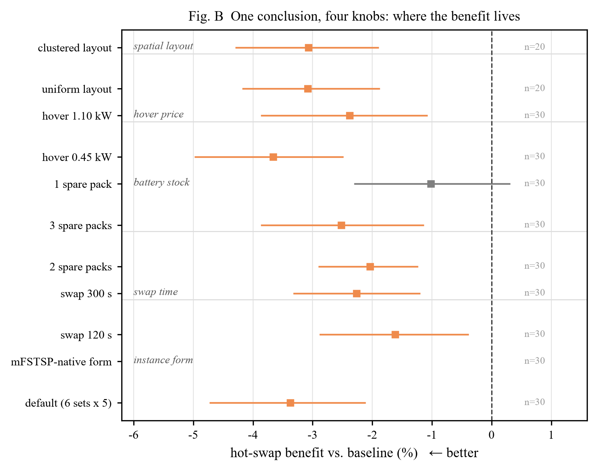

# TDDO

**卡车—无人机联合配送优化器**（Truck–Drone Delivery Optimizer）


TDDO 求解带时间窗、双向载荷与时空禁飞区的卡车—无人机协同配送问题。给定客户集合、需求、时间窗
与禁飞区，输出卡车路径、无人机架次的起飞与回收位置、起飞时刻与电池配置，目标为无人机电费、
卡车油费与司机工时之和最小。

模型采用混合整数线性规划，共 79 条约束；实际规模由自适应大邻域搜索（ALNS）求解，小规模算例由
Gurobi 求到最优。实验覆盖 16 个算例（10–100 客户）× 10 个随机种子，相对纯卡车方案成本降低 15.9%，
100 客户单次求解耗时 124–187 s。

### 核心功能

- **联合优化**：卡车路径与无人机架次（起飞/回收点、起飞时刻）联合决策，最小化电费、油费与司机工时之和。
- **完整约束**：时间窗、双向取派载荷、单架次电量上限、时空禁飞区（含时间相关绕行）。
- **双求解路径**：ALNS（4 个破坏算子 × 4 个修复算子 + 模拟退火）求解实际规模，Gurobi 求小规模精确解。
- **电池机制**：车载备用电池数量、换电耗时、载荷相关能耗与悬停计电，均可配置与消融。
- **真实路网**：广州天河 OSM 有向路网算例（set101–104）与高德矩阵变体（set111–114）。
- **可视化与验证**：高德底图解法页面（按车/架次筛选、初始/最终对比）、OR-Tools 外部基线、逐位回归与配对统计。

## 目录

- [1. 问题定义](#1-问题定义)
- [2. 数学模型](#2-数学模型)
- [3. 求解方法](#3-求解方法)
- [4. 实验结果](#4-实验结果)
- [5. 安装](#5-安装)
- [6. 使用](#6-使用)
- [7. 项目结构](#7-项目结构)
- [8. 正确性验证](#8-正确性验证)
- [9. 已知局限](#9-已知局限)
- [10. 参考文献](#10-参考文献)
- [11. 许可](#11-许可)
- [Abstract (English)](#abstract-english)

## 1. 问题定义

一辆卡车携带若干架无人机沿路网行驶。无人机可在任意停靠点（配送中心或客户点）起飞，独立服务
若干客户后在后续停靠点返回卡车。需要联合决策：

1. 卡车路径与各停靠点的服务分配；
2. 每个无人机架次的起飞点、回收点与服务客户序列；
3. 各架次的起飞时刻；
4. 车队规模、每车无人机数量与备用电池数量。

目标函数为三项运营成本之和：无人机电能消耗、卡车燃油消耗、司机工时。

问题的主要耦合来自三个方面：

- **时间同步**：架次起飞时刻受卡车到达时刻约束，回收时刻由飞行时间与服务时长决定，
  而卡车在回收点的等待决策又反过来影响后续到达时刻。
- **能量与载荷**：单段能耗与机上载荷线性相关，载荷随服务进程变化，故能耗须逐段累积，
  不可按平均值估算。
- **时空禁飞区**：航段是否可飞取决于飞行时刻是否落在禁飞时段内，绕行距离为时间相关的分段函数。

此外包含双向载荷（同时派送与取件）与单架次电量上限两项约束。

## 2. 数学模型

决策变量分为五组。

| 组别 | 符号 | 含义 |
|---|---|---|
| 路由 | `x[k,i,j]` | 卡车 k 是否经过弧 (i,j) |
| 架次 | `y[k,i,j]`、`wl/wr[k,i]` | 无人机自 i 起飞、于 j 回收；起降配对 |
| 时间 | `Tt[k,i]`、`Td[k,i]` | 卡车到达时刻、无人机起飞时刻 |
| 载荷 | `F/G[k,i]`、`ft[k,i]` | 剩余派件量、累计取件量、架次起飞装载量 |
| 能量 | `E[k,i]`、`ec[i,j]` | 累计能耗、单段能耗 |

79 条约束按功能分为七族：路由与流守恒、架次耦合、时间同步、时间窗、载荷、能量、空域。
完整的逐条公式与实现映射见 [`docs/笔记/约束逐条翻译.md`](docs/笔记/约束逐条翻译.md)。

实现上有一项影响较大的设计选择：约半数约束不在评估器中显式检验，而由解的表示层保证成立。
`Route → Sortie` 三层结构使「仅在停靠点起降」「流守恒」等条件无法被构造出来，评估器只需检验
其余部分，单次候选解评估耗时约 30 µs。该设计使 ALNS 在 2000 轮迭代下的计算开销可控。

## 3. 求解方法

**启发式求解。** 采用自适应大邻域搜索，包含四个破坏算子（随机移除、成本优先移除、
邻域相关性移除、卡车结构重组）与四个修复算子（随机插入、卡车优先插入、无人机优先插入、
均衡插入），接受准则为模拟退火，算子权重按四档表现自适应更新。

算子内另有两处针对本问题的策略：`related` 对禁飞区 2r 内的客户距离乘 0.6（这类客户共享同一条
绕行约束，需成片移除才能改变结构），`worst` 严格取节省额最高的 k 个。两处均做过单独消融：
前者关掉后全量 160 个配对的成本上升 0.31%（p=0.60），后者改为候选窗内随机抽样后成本上升 0.30%
（p=1.00）且单次求解耗时增加 24%。两项均无净收益，故保留现有实现，不作为改进计入。卡车修复的候选预算 `TOP_K`（默认 6）也做过
两端测试：缩到 1 会劣化 14.84%，放宽到 12 没有收益却慢 51%，说明默认值正好在拐点上。

**精确求解。** 小规模算例由 Gurobi 求解至最优，用途有二：一是标定启发式解的质量，
10 客户算例上 ALNS 与最优解的差距为 0–1.22%；二是为最优性论断提供依据，
第 4.2 节的模型改进结论依赖精确解而非启发式比较。

**工程优化。** 相对初始实现取得 4.6 倍加速，主要手段为几何距离缓存、路径评估结果记忆化、
违约早退，以及多进程逐行落盘以支持中断续跑。

## 4. 实验结果

实验设置：16 个算例（10、25、50、100 客户，两座城市，配送中心居中与边缘两种布局），
每个算例 10 个独立随机种子，每次求解 2000 轮迭代。

### 4.1 求解质量

| 指标 | 结果 |
|---|---|
| 相对纯卡车方案 | 成本降低 15.9%（同种子配对） |
| 相对初始可行解 | 成本降低 51.4% |
| 100 客户单次求解 | 124–187 s（20 核并行） |
| 10 客户算例与精确解差距 | 4/4 算例 gap 0%；ALNS 差距 0–1.22% |
| 禁飞区绕行的成本影响 | +0.5% |

禁飞区一项的结果低于预期。经分解，成本主要由司机工时构成，绕行增加的距离折算为时间后
在总成本中占比很小。该结论亦解释了后续多组实验中若干效应不显著的现象。

### 4.2 架次起降变量的建模改进

常规建模将「无人机在节点 i 降落」与「从节点 i 起飞」写入同一个 0-1 变量，导致同一节点
只能承担其中一项。而实际作业中，无人机在节点完成回收、更换电池后再次起飞属常规操作。
本项目将该变量拆分为到达与出发两组：

- 恢复「单节点单用途」约束后，最优值与原形式逐位相同，验证拆分未引入偏差；
- 移除该约束后，4 个 10 客户算例的最优值全部下降，幅度为 −0.17% 至 −4.33%，且均证到 gap 0%；
- 两组解的差异仅落在该条约束上，改进幅度可归因于该单一建模假设。

### 4.3 收益的边界

上述降幅并非定值。在同一组 30 个（算例, 种子）配对上逐一改变单一设定，结果如下：

| 设定 | 成本降幅 |
|---|---|
| 基准（电池不限、换电与悬停不计时） | −3.37% |
| 换电耗时 1 / 2 / 4 / 5 min | −2.36% / −1.62% / −0.79% / −2.26% |
| 每车备用电池 3 / 2 / 1 / 0 块 | −2.52% / −2.04% / −1.02% / **0.00%** |
| 悬停按 1.10 kW 计电 | −2.38% |
| 纯派送形态（无取件、无禁飞区、宽时间窗） | −4.29% |

备用电池为 0 时收益为零，原因并非收益衰减：此时单条路径最多允许一个架次，无人机落地后
不存在再次起飞的机会，换电机制在模型层面无法发生。

因此本项目对外报告区间 **1.5%–3.4%**，并附带适用条件：每车备用电池不少于 2 块、换电耗时
不超过 5 min。换电耗时测了 0 / 60 / 120 / 240 / 300 s 五档：0→240 s 单调下降，
但 300 s 又回到 −2.26%，与 240 s 的差为 −1.44%（22/8，p = 0.016），方向与直觉相反、
判为搜索噪声。因此只报区间，不给"每多一分钟扣多少"的斜率。



*图 1：30 个配对上逐一改变单一设定后的成本降幅及 95% 置信区间。区间跨越零线的仅有
「每车 1 块备用电池」一项。*

### 4.4 真实路网算例（广州天河）

基准算例的底图是西雅图与布法罗的 OSM 路网。另提供一组**天河真实路网**算例
（`set101`–`set104`，10 / 25 / 50 / 100 客户）：把原算例等比缩放搬到天河，
卡车距离与时间改由天河路网最短路给出（有向，含单行线），无人机仍按欧氏距离计算，
模型与求解器不变。

| 算例 | 客户 | 跨度 | 卡车距离中位 | 卡车 ÷ 无人机 |
|---|---|---|---|---|
| set101 | 10 | 6.5 km | 5.31 km | 1.68 |
| set102 | 25 | 6.5 km | 5.18 km | 1.88 |
| set103 | 50 | 6.5 km | 4.86 km | 1.84 |
| set104 | 100 | 6.5 km | 4.81 km | 1.95 |

对照基准算例的绕行倍数 1.40，天河路网让卡车多绕 20%–40%（珠江与快速路把城区切成块），
无人机的相对优势因此更大。该观察**不改变**第 4.1–4.3 节的任何数字：那些结论都在基准算例上
得到，天河需要重跑，两者不可混用。算例由 `python -m scripts.build_tianhe` 生成，
五项体检（连通性/三角不等式/对称偏差/绕行倍数/对角为零）全部通过。

底图来源做过交叉校验：用高德 Web 服务 API 对 1 100 个 OD 抽样比对，5 km 以上距离中位相差 **3%**、
但尾部很宽（P10 0.65 / P90 1.60），短距离因起终点语义不同不可比；时间口径差别更大
（高德含实时路况，中位是本项目自由流口径的 1.84 倍）。另外保留了一个高德矩阵变体 `set112`
用于对照（同布局、只换矩阵来源，车队从 4 辆变 6 辆、成本 +37%），默认数据源仍是可复现的 OSM。

**在这套算例上重跑主结论**（4 算例 × 10 种子，配对）：换电 **−2.13%**（35 好/5 差，p=1.4e-06）、
一车两机 −2.54%，与基准算例的 −2.26% / −2.94% 同量级；跨段锚点则完全失效
（m=2 臂内 −0.18%，15 好 15 差 10 平，p=1.00，而基准算例上是 −2.40%），
且 100 客户算例的 CPU 从 169.6 s 涨到 746.3 s。悬停按 1.10 kW 计电后，平均悬停从
70.0 min 降到 21.7 min、成本上升 1.67%——即"免费等待"在这套算例上高估了约 1.7% 的解质量。
详见 [`docs/设计笔记/M9.24_天河重跑.md`](docs/设计笔记/M9.24_天河重跑.md)。

解可以直接画在高德底图上：[`docs/web/tddo_map_set112.html`](docs/web/tddo_map_set112.html)
（高德静态底图内嵌，打开时不需要 Key；卡车折线取自真实路网最短路，无人机架次为虚线直线）。
页面支持按车/按架次勾选、全选/清空/反选，以及在「初始解 / 最终解」之间切换；卡车停靠点、架次起飞点（圆环）与归队点（方块）分别标注，可看出无人机是在卡车**后面某一站**落回，而不是回起飞点。
渲染统一复用 `or-research` skill 内置的 `amap/` 可视化模块（`adapt_tddo.py` 转 payload + `build_map.py` 出图），本项目只负责求解与解数据编码，不再维护第二份 HTML 模板；生成方式见
[`docs/设计笔记/M9.23_天河真实路网算例.md`](docs/设计笔记/M9.23_天河真实路网算例.md) §10。

### 4.5 外部基线（OR-Tools）

为回答与开源求解器的对比，用 OR-Tools `RoutingModel` 在同一批算例上求解纯卡车 VRPTW
子问题：节点、时间窗、有向路网矩阵、车数、服务时间与成本系数均与 `Instance` 一致，
司机工时通过时间维度 span cost 计入（含时间窗等待），目标值与项目评估器重算值在 8/8 算例上差值为 0。
该子问题**放松了取件载荷，且不表达无人机同步 / 换电 / 电量 / 禁飞区**，不能当作原问题的下界。

| 对照 | 结果 |
|---|---|
| 西雅图 10 / 25 / 50 客户，OR-Tools vs ALNS 纯卡车 | 差异 ≤0.01% |
| 西雅图 100 客户 | OR-Tools 略优 0.21%（40 s 限时） |
| 天河 100 客户 | ALNS 纯卡车优 4.5%，且墙钟约 27 s < OR-Tools 40 s |
| 全模型 vs 纯卡车（天河 100 客户） | 成本降低 10.7%；西雅图 16%–29% |

复现：`python -m scripts.ortools_baseline`。原始表见 `results/ortools_baseline.csv`，
口径与面试话术见 [`docs/求职_外部基线.md`](docs/求职_外部基线.md)。

### 4.6 业务口径换算

把 `set104` 映射为「天河片区一天 100 单冷链补货」（均单 6.7 kg、7 辆车、14 架次），
按 `configs/config.toml` 的成本系数与显式汇率/排放假设换算：卡车 + 无人机 ¥22.85/单，
纯卡车 ¥25.60/单，节省 **¥2.74/单（10.7%）**；司机工时占模型成本 81%，
CO₂ 由 1.88 降至 1.42 kg/单。绝对值仅为量级示例，不构成报价；详见
[`docs/求职_业务场景.md`](docs/求职_业务场景.md)。

## 5. 安装

环境要求：Python 3.13。核心求解与实验的依赖见 `requirements.txt`（numpy、pandas、matplotlib、
gurobipy、alns）；pytest 与 OR-Tools 基线见 `requirements-dev.txt`；可选的 ML 预筛见
`requirements-ml.txt`。精确求解（Gurobi）需要有效许可证；未配置许可证时，除精确求解与标记为
`slow` 的测试外，其余功能均可运行。

```bash
python -m venv .venv && .venv/Scripts/activate     # Linux/macOS: source .venv/bin/activate
pip install -e ".[dev]"     # 安装依赖并注册 tddo 命令；[dev] 含 pytest 与 OR-Tools
tddo doctor                 # 环境体检：依赖 / 配置 / 数据 / 密钥状态

# 算例底图数据（83 MB，未纳入版本控制）
git clone --depth 1 https://github.com/optimatorlab/mFSTSP.git data/raw/mFSTSP

# 生成 16 个基准算例
python -m src.generator
```

不安装包也可以用 `python -m src.cli ...`；原有的 `python -m scripts.xxx` 调用方式继续有效。

### 5.1 API Key 配置（高德，可选）

只有调用高德接口的功能需要 Key：`scripts/amap_check`（交叉校验）、
`scripts.build_tianhe --matrix amap`（高德距离矩阵）、`scripts.export_web`（出图时需要
`AMAP_KEY` 拉静态底图；`--static` 额外出 PNG，`--amap-js` 额外出可拖拽版页面）。
其余功能（含 OSM 路网构建、全部求解与实验）都不需要。
`AMAP_JS_KEY` / `AMAP_JS_SECRET` 只在需要拖拽缩放时配；默认页面不写任何前端凭据，可提交到公开仓库。

Key 放在项目根目录的 **`.env`**，代码里不出现明文：

```bash
cp .env.example .env        # Windows: copy .env.example .env
# 然后编辑 .env，填入三行
```

| 变量 | 用途 | 申请平台 |
|---|---|---|
| `AMAP_KEY` | `v3/distance` 距离矩阵、`v3/staticmap` 静态图 | Web 服务 |
| `AMAP_JS_KEY` | 浏览器端加载地图 SDK | Web端(JS API) |
| `AMAP_JS_SECRET` | JS API 2.0 的安全密钥，与上一项成对 | 同上 |

读取逻辑在 `src/env.py`，优先级为 **进程环境变量 > `.env` > 代码默认值**，因此临时覆盖
不需要改文件：

```bash
AMAP_KEY=另一个key python -m scripts.amap_check     # 仅本次生效
```

`.env` 已加入 `.gitignore`（`.env.example` 是字段模板，会入库）。缺 Key 时的报错会直接指出
去 `.env` 里填哪一项，而不是抛 `KeyError`。日志里只打印脱敏后的 `c276…d3a8`。

### 5.2 模型与算法配置（`configs/`）

配置文件用 TOML，代码内部统一 SI 单位（m / s / kg / kWh），配置文件可按论文原单位（lb / km / h）
书写，读取时统一换算（见 `src/instance.py`）。`config.toml` 的分节如下：

| 分节 | 内容 |
|---|---|
| `[fleet]` | 无人机速度/载荷/电池、卡车容量、起降与服务时长、每车无人机数、备用电池、换电耗时 |
| `[energy]` | 无人机与卡车能耗系数、悬停功率 |
| `[cost]` | 电费、油费、司机工时单价 |
| `[generation]` | 取件比例、时间窗、禁飞区数量/半径/时段、随机种子（算例生成规则，见 `src/generator.py`） |
| `[fleet_size]` | 卡车数量策略与上下界 |
| `[alns]` | 温度/冷却率、破坏率、迭代与种子数、四档权重 |
| `[gurobi]` | 精确求解时限与 gap |

`instances.toml` 定义算例清单：每条给出 `id`、`n_customers`、`city`、`depot` 与 `problems`，
天河算例另有 `source`、`base` 指向底图。共 24 条：`set1`–`set16` 为基准算例
（西雅图/布法罗，10–100 客户），`set101`–`set104` 为天河 OSM 路网算例，
`set111`–`set114` 为对应的高德矩阵变体。
单次实验的开关大多也可由命令行覆盖，见第 6 节与 `docs/工程手册.md`。

## 6. 使用

```bash
# 环境体检（装好就能跑，缺什么会直接列出来）
tddo doctor

# 单算例求解：写出含卡车路径、无人机架次、成本拆分的 JSON
tddo solve --set 104 --iters 300 --seed 0

# 项目自检：检查产物完整性与默认口径是否被修改
tddo check                       # 加 --with-tests 可一并跑快速测试

# 批量实验 / 外部基线 / 地图可视化（参数原样透传给对应脚本）
tddo bench --sets 104 --seeds 3 --iters 1000
tddo baseline
tddo export-web --set 112

# 规模压测（工程指标，约 5 分钟）：10–500 客户，固定 50 轮，不写进论文表格
python -m scripts.scale_bench --iters 50
python -m scripts.scale_fig

# 快速验证：小轮数、少算例，约 4 分钟，不覆盖已有结果
python -m scripts.reproduce --quick

# 全量实验：约 1.6 小时（20 核）
python -m scripts.reproduce

# 单元测试
pytest -q -m "not slow"
```

### 6.1 容器运行

```bash
docker build -t tddo:latest .
docker run --rm tddo:latest tddo --help

# 数据与结果挂载进容器；密钥用 --env-file，不写进镜像
docker run --rm -v "%cd%/data:/app/data" -v "%cd%/results:/app/results" \
  --env-file .env tddo:latest tddo solve --set 104 --iters 300
```

镜像里不含 83 MB 算例底图、`.env` 与 Gurobi 许可证；精确求解时再挂载 `GRB_LICENSE_FILE`。

单组实验通过 `python -m scripts.bench --exp <实验名>` 运行，常用参数如下：

| 参数 | 说明 |
|---|---|
| `--sets` | 算例编号，如 `5,7,9,12,13,15` |
| `--seeds` | 随机种子数量 |
| `--iters` | ALNS 迭代轮数 |
| `--hotswap` | 允许同一节点先回收再起飞 |
| `--drones-per-truck` | 每车可同时作业的无人机数量 |
| `--swap-time` | 换电耗时（秒） |
| `--spare-batteries` | 每车备用电池数量，`-1` 表示不限 |
| `--hover-power` | 悬停功率（kW），`0` 表示悬停不计电 |
| `--nfz-discount` | `related` 中禁飞区客户的距离权重，`1.0` 关闭该偏好 |
| `--worst-window` | `worst` 的候选窗系数，`1.0` 为严格取前 k |

完整的开关说明与参数默认值见 [`docs/工程手册.md`](docs/工程手册.md)。

## 7. 项目结构

```
pyproject.toml    打包配置与 tddo 命令注册（pip install -e .）
requirements*.txt 运行/开发/ML 依赖（见 §5）
Dockerfile        容器镜像定义（数据、密钥、许可证不进镜像）
.env.example      密钥字段模板（复制成 .env 使用；.env 不入库）
configs/          模型与算例参数（TOML，见 §5.2）
data/instances/   24 个算例 JSON：16 基准 + 8 天河（4 OSM + 4 高德矩阵变体）
data/tianhe/      天河底图矩阵与抓取元数据（原始路网不入库）
data/raw/mFSTSP/  算例底图数据（83 MB，未纳入版本控制）
src/              模型、算法与 CLI，30 个模块，约 6.4k 行
scripts/          实验、诊断、绘图、算例构建与自检，44 个脚本，约 7.5k 行
tests/            31 个测试文件，341 项测试
results/          110 份结果 CSV 与主图（figs/）
docs/             项目设计、成果报告、工程手册、设计笔记与求职材料
```

文档索引：

| 内容 | 位置 |
|---|---|
| 项目设计：问题、建模、算法、验证 | [`docs/项目书.md`](docs/项目书.md) |
| 成果报告：主图、结论、边界与负结果 | [`docs/成果整合.md`](docs/成果整合.md) |
| 工程手册：运行方式与全部开关 | [`docs/工程手册.md`](docs/工程手册.md) |
| 结论清单与证据强度分级 | [`docs/设计笔记/结论总览.md`](docs/设计笔记/结论总览.md) |
| 起降变量拆分的完整形式与验证 | [`docs/设计笔记/W1_换电模型设计.md`](docs/设计笔记/W1_换电模型设计.md) |
| 约束逐条翻译（公式与实现） | [`docs/笔记/约束逐条翻译.md`](docs/笔记/约束逐条翻译.md) |
| 天河真实路网算例的构建与体检 | [`docs/设计笔记/M9.23_天河真实路网算例.md`](docs/设计笔记/M9.23_天河真实路网算例.md) |
| 规模压测（工程指标，含曲线） | [`results/scale_bench.md`](results/scale_bench.md) |
| 文献定位与 related work 草稿 | [`docs/求职_文献定位.md`](docs/求职_文献定位.md) |

## 8. 正确性验证

项目采用四类相互独立的验证手段：

1. **逐位回归**：`scripts.golden_check` 校验固定种子下的目标值是否与基线完全一致。
   默认参数下的任何改动若影响结果，该检查即失败；性能优化过程中结果未发生任何变化。
2. **配对统计**：所有方案对比均在相同（算例, 种子）配对上计算相对差，不使用各种子最优值，
   以避免极值偏差。
3. **最优性等价**：模型的每次重构均要求「恢复原约束后与原形式逐位相同」，
   以此排除重构引入的偏差。
4. **双实现互查**：MILP 解转换为内部解结构后由评估器复算目标值与可行性，
   两者须一致；不一致即表明至少一方存在实现错误。

## 9. 已知局限

1. **算例为自行构建。** 底图坐标取自公开路网数据，需求、时间窗、禁飞区与车队规模由规则生成，
   种子固定，生成规则见 `configs/`。因此算例间结果可比，绝对成本不宜与其他研究直接比较。
2. **精确模型不含禁飞区与悬停。** 绕行距离为时间相关的分段函数，线性化代价过高；
   悬停同理。最优性结论仅在悬停不计电的口径下成立。
3. **真实算例上限 100 客户。** 200/500 客户仅做合成聚簇的固定预算压测（50 轮、单种子，见
   `results/scale_bench.md`），只回答“跑不跑得动”，不报成本收益、不作统计结论，亦不外推。
4. **敏感性分析为单参数。** 各设定分别测试，未做联合扰动，叠加后的数值不可由单参数结果推得。
5. **高德矩阵为可选对照变体。** 默认数据源仍是可复现的 OSM；高德结果含实时路况口径，与自由流口径
   不可直接混用（见 §4.4）。

## 10. 参考文献

问题形式与模型符号沿用该领域的主流建模；求解器、评估器、扩展实验与结论为本项目实现，
不含第三方代码。

- Zeng J., Hu Y., Pei M. (2026). Optimizing bidirectional delivery with multiple drones and
  trucks. *Transportation Research Part E*, 205, 104511.
- Murray C., Raj R. (2020). The multiple flying sidekicks traveling salesman problem.
  *Transportation Research Part C*, 110, 368–398.（算例底图数据来源）

论文原文与出版方图件受版权保护，未纳入本仓库。

## 11. 许可

MIT License，详见 [`LICENSE`](LICENSE)。

---

## Abstract (English)

**TDDO** is an optimizer for truck–drone tandem delivery with time windows, bidirectional loads
and time-dependent circular no-fly zones. Given a customer set with demands and time windows,
it decides truck routes, drone sorties (launch and recovery nodes), launch times and battery
logistics, minimizing drone electricity, truck fuel and driver hours.

The model is a mixed-integer linear program with 79 constraints in seven families. Realistic
instances are solved by a custom adaptive large neighbourhood search; Gurobi is used to certify
small instances. On 16 instances (10–100 customers) × 10 seeds, the solution is 15.9% cheaper
than a truck-only plan and 51.4% below the initial feasible solution; 100-customer instances
take 124–187 s.

Splitting the single recover-or-launch flag into separate arrival and departure variables lowers
the proven optimum on 4 of 4 small instances (−0.17% to −4.33%, all at 0% gap). The resulting
cost reduction is conditional, ranging from 1.5% to 3.4% depending on swap duration, battery
stock and instance form.
