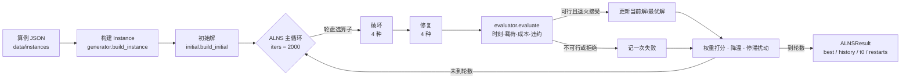
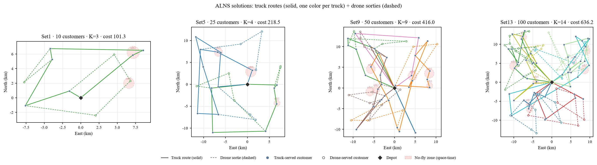
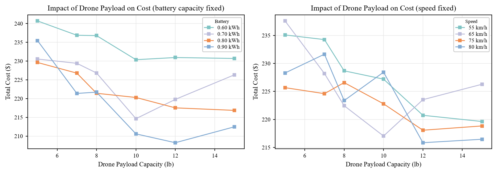
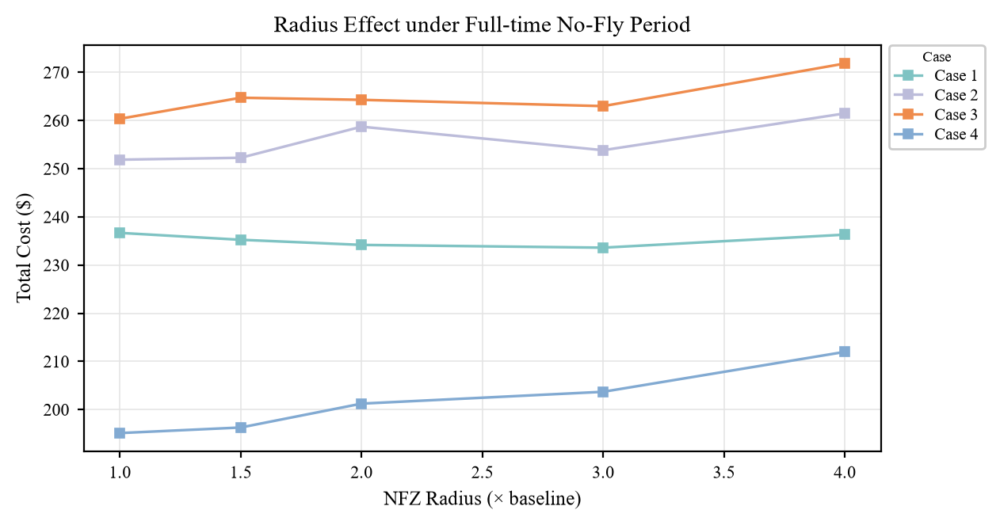

# 卡车-多无人机双向配送（含时空禁飞区）· 论文复现

> 复现对象：Zeng J., Hu Y., Pei M. (2026). *Optimizing bidirectional delivery with multiple drones and trucks: a mixed-integer nonlinear model to addressing no-fly zone constraints.* **Transportation Research Part E, 205, 104511.** DOI [`10.1016/j.tre.2025.104511`](https://doi.org/10.1016/j.tre.2025.104511)
>
> **独立复现**：模型、算法、实验全部依据公开论文与公开数据集自行实现，不含原作者代码。算例改造规则论文未公开，本项目自定（见 §6）。因此**趋势对齐、绝对数值不对齐**，本文所有结论都标注了口径。

**一句话结果**：16 个算例、ALNS 2000 轮 × 10 种子，**节省率 51.4%（论文 ≈52%）**；10 客户 4 个算例 **Gurobi 全部证到最优**（ALNS gap 0–1.22%）；100 客户 **CPU 124–187 s（论文 159–254 s）**；PSO 全面劣于 ALNS（+13.3%，论文同向）。**唯一差一个量级的是 Without-detour 列（0.5% vs 8.2%）**，已用算术上界证明是成本结构所致，不是实现缺陷。

---

## 1. 与论文的对齐度（先看这张表）

| 维度 | 论文 | 本项目 | 判断 |
|---|---|---|---|
| Saving%（初始解→ALNS） | 38.5 – 67.9，均值 ≈ 52 | **32.5 – 68.7，均值 51.4 / 中位 53.2** | ✅ 区间与均值都对得上 |
| 10 客户 vs 精确最优 | gap = 0 | **0 / 0 / 0.004 / 1.22%**（MILP 4/4 证最优） | ✅ 秒级达到 |
| ALNS 用时 | 100 客户 159–254 s | **124–187 s** | ✅ 同量级（Python 单线程评估器） |
| PSO 对照 | 全面劣于 ALNS，0 – 20.2% | **1.7 – 25.2%，均值 13.3%** | ✅ 方向与量级一致 |
| 相对 Truck-only | 4.4 – 54.1%，均值 20.8 | **6.5 – 40.4%，均值 15.8** | ◐ 方向对，上沿偏小 |
| 相对 Without-detour | 0 – 21.2%，均值 8.2 | **−1.2 – +2.6%，均值 0.5（配对 0.9）** | ✗ 差一个量级，已归因（§7） |
| Fig.9 容量–成本 | 150→300 lb 最陡，350 以上趋平 | **150→300 降 20.5–36.7%，300 以上趋平** | ◐ 拐点一致，我们「平」得更彻底 |
| Fig.10 载荷–续航 | 载荷↑ 成本↓，续航越长收益越大 | **0.9 kWh：5→12 lb 降 11.6%；0.6 kWh 仅 4.1%** | ✅ 交互方向一致 |
| Fig.11 时段 | 无 → 工作时段 → 全天，成本递增 | **全天 vs 无禁飞 +2.3 ~ +7.4%** | ◐ 方向对，幅度偏小 |
| Fig.11 半径 | 影响强于时段 | **1×→4× 仅 +2 ~ +5%** | ✗ 排序相反，已定位为时段覆盖率 |
| Fig.12 任务数 | 随半径**非单调** | **Case4：3.8→4.0→4.2→4.4→3.4** | ✅ 两种机制都复现 |

三类差距的完整清单见 §7，逐条证据见 `M6_对标结果.md`、`M7_灵敏度分析.md`、`Without-detour_幅度诊断.md`。

---

## 2. 模型

### 2.1 问题

一个仓库 0、一批客户 `U*`，每辆卡车配属 **1 架** 无人机。卡车沿路网行驶，无人机可在**任意客户点**起飞/回收，
一个架次可连续服务多个客户再飞回卡车；飞行需绕开**带时间窗的圆形禁飞区**。客户同时有**派件** `f_i` 与
**取件** `g_i` 需求，卡车与无人机各有载荷上限。目标是最小化「无人机电费 + 卡车油费 + 司机工时费」。

### 2.2 符号

| 类别 | 记号 | 含义 |
|---|---|---|
| 集合 | `K` / `U = {0} ∪ U*` / `H` | 卡车 / 节点（0 为仓） / 禁飞区 |
| 参数 | `Q^truck, Q^drone` | 卡车、无人机载荷上限 |
| 参数 | `E_max, η^SoC, v^drone` | 电池容量、单架次可用比例、巡航速度 |
| 参数 | `e^drone, b, e^truck` | 无人机单位载荷-距离能耗、空载单位距离能耗、卡车油耗 |
| 参数 | `c^drone, c^truck, c^customer` | 电价、油价、司机工时单价 |
| 参数 | `D^truck_ij, D^drone_ij, d_ijh` | 卡车路网距离、无人机直线距离、绕禁飞区 h 的增量 |
| 参数 | `[e_i, l_i], τ_ij, γ_ih` | 客户时间窗、飞行/行驶时间、节点 i 是否落在圆 h 内（空间判定） |
| 变量 | `x^k_ij, y^k_ij, α^k_ij` | 卡车走 i→j、无人机**自己飞** i→j、卡车**载着**无人机走 i→j |
| 变量 | `w^k_i` | 卡车 k 在 i 起飞或回收（论文用同一个 0-1 表达两件事） |
| 变量 | `T^T_i, T^D_i` | 卡车 / 无人机到达 i 的时刻 |
| 变量 | `F^k_i, G^k_i` | 卡车到达 i 时的派件 / 取件在车载量 |
| 变量 | `f^a_i, g^a_i, f^t_i, g^t_i` | 无人机到达 i 时 / 交接后的派件、取件在机量 |
| 变量 | `z^start_ih, z^end_ih, δ_ih, s_ih` | 时间判定的四个 0-1；`s = γ·δ` |

### 2.3 目标函数（论文式 74）

$$
\min\; c^{drone}\sum_{k}\sum_{i\neq j}\Big[\big(e^{drone}(f^{a,k}_{j}+g^{a,k}_{j})+b\big)\big(D^{drone}_{ij}+\textstyle\sum_h d_{ijh}(z^{end,k}_{ih}-z^{start,k}_{jh})\big)\Big]y^k_{ij}
\;+\; c^{truck}\sum_{k}\sum_{i\neq j} e^{truck}D^{truck}_{ij}x^k_{ij}
\;+\; c^{customer}\sum_{k} T^{truck,k}_{U+1}
$$

三项分别是无人机电费（**按该段机上载荷**计，含绕行距离）、卡车油费、全体司机的工时费（按各车回仓时刻计）。
第三项是「用无人机换时间」的直接激励——本项目里它占总成本的 **68–79%**，这也是理解后面所有结论的关键。

### 2.4 约束地图（(2)–(79)，共 79 条）

完整逐条翻译（公式 + 直译 + 为什么需要 + 启发式怎么处理）见 `约束逐条翻译_2-79.md`。
下表的「本项目」列是**这条约束由谁负责**：

| 组 | 编号 | 作用 | 本项目 |
|---|---|---|---|
| 路径 | (2)–(12) | 出入仓唯一、流守恒、`α+y ≤ 1`、消子环 | **结构自动** |
| 禁飞 | (13)–(15) | 禁飞期内不得从被禁节点起飞/降落/作业 | 显式（`service_ok`） |
| 访问 | (16)–(19) | 每客户恰被一个「车-机」对访问一次 | **结构自动** |
| 同步 | (20)–(21) | `w` 的语义：起降必须发生在卡车在位时 | 显式（`DRONE_BUSY` / `LR_SAME_NODE`） |
| 时刻 | (22)–(24) | 卡车到达递推（≥，须等机）、无人机到达递推 | 显式（逐段推进） |
| 时刻 | (25)–(31) | `z^start/z^end` 的 M 大法、rendezvous 同步 | 显式（等价改写，见 §3.6） |
| 时刻 | (32)–(34) | `δ`、`s = γ·δ` | 显式 |
| 时间窗 | (35)–(38) | `T_i + τ_ij ≤ l_j`，**不是** `T_j ≤ l_j` | 显式（易错点） |
| 能耗 | (39)–(43) | 逐段累加、起飞清零、单架次 ≤ `η·E_max` | 显式 |
| 序列 | (44)–(49) | 起终点、不重复访问、序关系、行驶中不许起飞 | 结构 + 显式 |
| 载荷 | (50)–(73) | 双向载荷递推（含交付/回收）、卡车与无人机容量 | 显式（最易错） |
| 目标 | (74)–(79) | 目标与 McCormick 线性化 | 启发式直接算 (74)；`q` 只有 MILP 需要 |

**为什么一半约束能「结构自动」**：解的表示把「谁服务谁、在哪个位置起降」直接写进了数据结构
（§3.2），流守恒、唯一访问、起降点在卡车路径上这三类约束就无从违反。剩下的才是真要写代码检查的。

### 2.5 四处建模口径（与论文的差别都在这里）

| 项 | 论文 | 本项目 | 理由 |
|---|---|---|---|
| 早到 | (35) 字面禁止早到 | **允许早到、原地等待** | 与「推迟出发」等价，不改可行域，省掉为每个客户优化出发时刻 |
| 虚拟返回仓 `U+1` | 建一个虚拟节点承接无人机回仓 | 不建，用弧 `(i, 0)` 表示 | 同一件事，少一类节点 |
| 车队规模 | 未说明 | `K = max(⌈Σf/Q_truck⌉, 时间窗所需路线数)` | 只按容量会低估一半（Set1 容量只需 1 辆、时间窗要 3 辆） |
| 成本系数 | 只给符号 | 按物理量级取（空载航程 ≈ 31 km） | 论文未给值，故**只报相对量** |

---

## 3. 算法

### 3.1 框架



一次求解 = 1 个初始解 + 2000 轮「破坏-修复-评估-接受」，每轮只产生并评估 **1 个**候选解
（这一点决定了后面 PSO 的预算口径）。

### 3.2 解的表示：让约束自己成立

```
Solution
└── Route(truck=k, nodes=[0, c1, c2, …, 0], sorties=[Sortie(launch, recover, customers)])
      sorties：该车无人机的架次；launch / recover 是 nodes 的**位置下标**（架次锚定在相邻两节点之间）
```

- `nodes` 是一辆车的完整卡车路径，`sorties` 里每个架次把「起飞位置 → 服务客户序列 → 回收位置」写死；
- 于是「无人机只在卡车停靠点起降」「每个客户只被访问一次」「流守恒」**无法被违反**，不需要检查；
- 但**位置下标会随增删平移**，所以算子内部一律先转成「按节点编号的锚点描述」
  （`route_to_specs` / `route_from_specs`），这是本项目踩过两次的坑。

### 3.3 初始解（论文 Algorithm 2 的两阶段）

| 阶段 | 做什么 | 关键细节 |
|---|---|---|
| ① 建卡车路线 | 按「最不灵活优先」把客户追加到路线尾部 | 排序键 `slack = l_i − 最早可行到达`，取最小者；装不下就收车返仓开新路线 |
| ② 改派给无人机 | 把卡车客户按 slack 从小到大改派成架次 | 锚点 = 该客户在路径上的**前驱**（起飞）与**后继**（回收）；用 `evaluate` 做全链路四点校验（载荷/时间/序列/能耗），不通过就换下一个 |

阶段②之后还会做一次全解 `evaluate`，不可行就抛错——**初始解必须可行**才能进主循环，
否则退火会在不可行域里乱走（早期版本踩过）。

### 3.4 ALNS 的五个部件

| 部件 | 本项目实现 |
|---|---|
| **破坏（4）** | `random` 随机移除 · `worst` 按「移除该客户的节省额」降序，在最前 2k 名里随机取 k · `related` 以随机客户为种子按距离取近邻（**禁飞区 2r 内的距离打 6 折**，让共享同一绕行约束的客户成片移除）· `shuffle` 打乱一条卡车路线的内部顺序，锚点失效的架次整段移除 |
| **修复（4）** | `random` 随机顺序 + 随机候选 · `truck` 卡车直服优先，末尾再做一次「卡车客户 → 同车架次」的**二次转换** · `drone` 无人机架次优先 · `equal` 两条通道候选合并后取增量最小。候选先按「距离/能耗增量」粗排，只对前若干名做完整评估 |
| **接受** | 模拟退火：`Δ<0` 必收，否则以 `exp(−Δ/T)` 收；`T ← αT` |
| **权重** | 轮盘赌选算子；四档打分 `全局最优 +2 / 改进 +1 / 被接受 +0.5 / 被拒绝 ×0.9`，**加下限 0.05** 防算子饿死（论文无下限，早期运气差的算子会永久失活） |
| **停滞** | 连续 200 次没刷新全局最优 → **随机移除 50% 客户再插回**并把温度抬回 `0.2·T0`；扰动后若成本超过最优 1.3 倍则退回最优 |

参数（`configs/config.toml`，`tune=True` 时生效）：

| 参数 | 论文 | 本项目 | 为什么改 |
|---|---|---|---|
| 迭代数 | 2000 | 2000 | 同 |
| 初温 `T0` | 固定 300 | **`Δ_med / ln2`**（中位上升步接受率 50%） | 300 是对论文成本尺度（13–285）调的，我们的成本是 68–920，等于前几十轮随机游走 |
| 降温 `α` | 0.99 | **`(1e-3)^(1/iters)`** | 与预算挂钩：α=0.99 配 2000 轮，第 1000 轮温度已降到 0.013，后半程变纯爬山 |
| 破坏率 | 固定 30% | **每轮 `U(10%, 40%)`** | 固定 30% 在 100 客户时接近「重建半张图」，单轮代价过高 |
| 停滞处理 | 回退到最优 | **扰动 + 抬温** | 回退到最优只是回到同一吸引域，没有跳出机制（Set13 曾在 60 轮后完全停滞） |

消融（`--no-tune` 复原论文原参数，5 种子同口径）：三处修正带来 **+1.76%** 的配对改进，12/16 个算例为正。

### 3.5 评估器：一次 `evaluate` 做什么

```
逐路线 → 沿 nodes 推进：卡车服务/等待 → 起飞/回收架次 → 逐段累加能耗与载荷
        → 收集违约 → 汇总成本（无人机电费 + 卡车油费 + 司机工时）
```

| 违约码 | 含义 |
|---|---|
| `TW_TRUCK` / `TW_DRONE` | 卡车 / 无人机超出客户时间窗 |
| `CAP_TRUCK` / `CAP_DRONE` | 卡车 / 无人机超载（双向载荷合计） |
| `SOC` | 单架次能耗超 `η·E_max` |
| `NFZ` | 禁飞导致航段不可飞或节点不可起降 |
| `DRONE_BUSY` | 同一架无人机的两个架次时间重叠（**每车只有一架**） |
| `LR_SAME_NODE` | 同一节点既回收又起飞（论文单个 `w_i` 表达不了，会让递推 (23) 自相矛盾） |

两条硬规则是**必须显式**检查的：漏了 `DRONE_BUSY`，一车能同时飞两个架次，成本低估十几个百分点，
ALNS 会主动去找这种非法解（本项目修此 bug 前算出过**比 MILP 最优还低**的成本）。

算子内部筛候选时用 `fast=True`：一发现违约立刻返回，把「明显不可行」的候选从 `O(路径全长)` 降到 `O(违约位置)`；
只在 `feasible` 为真时读成本，所以早退不改变任何决策。

### 3.6 几何与能耗

**禁飞判定两层**（论文 Fig.3）：

```
γ_ih  空间：节点 i 是否落在圆 h 内            → 预处理成「节点 → [禁飞区]」表
δ_ih  时间：到达时刻是否落在 h 的禁飞窗口内    → 运行时判
s = γ·δ = 1 → 该点禁飞期内不可起降，任务只能交给卡车
```

**航段是否需要绕行**（论文 Fig.4）：判据是「飞行区间 `[T_i, T_j]` 与禁飞窗口是否相交」，等价于
`z^end_ih − z^start_jh = 1`。六种端点情形里 **cases 2–5 都要绕**——不是「起点在禁飞前、终点在禁飞后」那么简单：

| 情形 | `T_i` | `T_j` | 是否绕行 |
|---|---|---|---|
| 1 | 禁飞前 | 禁飞前 | ✗ |
| 2–5 | 禁飞前 / 禁飞中 | 禁飞中 / 禁飞后 | **✓** |
| 6 | 禁飞后 | 禁飞后 | ✗ |

**绕行距离**（论文 Fig.5 / 式 1）走「切线 → 圆弧 → 切线」：`d_ijh = (√(|oi|²−r²) + rθ + √(|oj|²−r²)) − l`。
若任一端点在圆内，切线不存在，直接判不可行（交给 `γ·δ`，而不是硬算一个绕行距离）。

**能耗**（式 39）：`E = d·(e^drone·L + b)`，`L` 是该段的机上载荷（派件 + 取件）；卡车按路网距离 × 油耗；
司机工时按各车回仓时刻 × 单价。`b` 在论文 Table 2 里标成 kWh，代入式(39) 必须是 kWh/km——按笔误处理。

### 3.7 性能：四个手段与一笔总账

| 手段 | 效果 |
|---|---|
| **静态几何缓存**（`cache.py`） | 距离、`γ`、需求、时间窗、路网矩阵一次性算好；内循环只查表。缓存以「禁飞区对象身份」失效，`replace(nfz=…)` 自动触发重建 |
| **`d_ijh` 预计算** | 绕行量是纯几何量、与时间无关，可按「圆 × 点对」预计算，不必在 80 万次内循环里重算 |
| **纯 Python 扁平数组** | 把 numpy 标量换成 `tuple`/`float`——内循环里 numpy 标量索引要建 `np.float64` 对象，慢 3–4 倍 |
| **候选粗排 + 早退** | 修复算子只对前几名做完整评估；`fast=True` 遇违约即返回 |
| 合计 | 单轮 370 → **81 ms**（Set13，100 客户），**4.6×**，结果逐位不变（`golden_check` 守门） |

### 3.8 PSO 对照（Table 3 的 PSO 列）

论文只给了 PSO 的参数（学习因子 2.05、惯性权重 0.9→0.4、与 ALNS 同预算），**没给粒子编码**。
本项目用标准 **random-key**：粒子是 n 维优先级向量 → 升序得到插入顺序 → 复用初始解的尾部追加构造
→ 每条路线按 min-slack 改派架次 → `evaluate`。预算定义为「解码次数 = ALNS 迭代数 = 2000」
（种群 20 → 101 轮，实际 2020 次解码），否则种群 20 的 PSO 会多评估 20 倍解。
解码器与 ALNS 初始解同一套，所以「PSO 输」不是输在解码器上。

---

## 4. 快速开始

```bash
python -m venv .venv
.venv/Scripts/activate                 # Windows（Linux/macOS: source .venv/bin/activate）
pip install -r requirements.txt

# 算例数据（83 MB，不入库）
git clone --depth 1 https://github.com/optimatorlab/mFSTSP.git data/raw/mFSTSP
python -m src.generator                # 生成 data/instances/set01..16.json（金标准，勿手改）

python -m scripts.reproduce --quick    # 冒烟：约 4 分钟，只验证链路
python -m scripts.reproduce            # 全量：约 1.5 小时（20 核）
```

`scripts.reproduce` 只是按顺序调用下表这些独立脚本，单步失败可照着打印出的命令重跑。

| 步骤 | 命令 | 产物 | 全量耗时 |
|---|---|---|---|
| 主实验 | `scripts.bench --exp main --seeds 10 --iters 2000 --refresh` | `results/bench_main.csv` | 15 min |
| 无绕行对照 | `scripts.bench --exp nodetour --no-detour ...` | `bench_nodetour.csv` | 17 min |
| 纯卡车对照 | `scripts.bench --exp truckonly --no-drone ...` | `bench_truckonly.csv` | 4 min |
| 参数消融 | `scripts.bench --exp ablate --no-tune --seeds 5 ...` | `bench_ablate.csv` | 10 min |
| PSO 对照 | `scripts.bench_pso --seeds 10 --iters 2000` | `bench_pso.csv` | 4 min |
| 汇总 | `scripts.summarize_bench` | `results/table3_v2.csv` / `.md` | 秒级 |
| 灵敏度 | `scripts.sensitivity --which all --refresh`（四组可并行） | `sens_*.csv` + Fig.9–12 | 5 min（并行） |
| 路线图 | `scripts.plot_routes --refresh` | `results/figs/routes_fig8.png` | 4 min |
| 精确解 | `scripts.run_milp` | `results/milp_check.csv` | 9 min |

Gurobi 需自备学术许可证，验证：`python -c "import gurobipy as gp; gp.Model(); print('ok')"`。
没有许可证时除 `run_milp` 与 4 项 `-m slow` 测试外，其余全部可跑。

### 4.1 三个「对照臂」开关

| 开关 | 作用 | 成本的走向 | 对应 Table 3 的哪一列 |
|---|---|---|---|
| `allow_drones=False` | 不派无人机 | 变高 | **Truck-only** |
| `allow_detour=False` | 禁飞区照查，但穿圆的航段**不许绕**（直接不可飞） | 变高 | **Without-detour** |
| 清空 `nfz`（只在诊断里用） | 禁飞区整个删掉 | 变低 | 不是 Without-detour |

Without-detour 是**收紧**而不是放开——论文该列 Increasing% 全为正，就是这个原因。

---

## 5. 结果

### 5.1 Table 3（论文同口径：各种子取最优）

完整表见 [`results/table3_v2.md`](results/table3_v2.md)，列含义：`Saving` = 初始解→ALNS 的降幅，
`+%` = 该列成本相对 ALNS 成本的增加。

| Set | n | K | ALNS | Saving | CPU | Truck-only | +% | No-detour | +% | PSO | +% |
|---|---|---|---|---|---|---|---|---|---|---|---|
| 1 | 10 | 3 | 99.93 | 61.0% | 1.4s | 126.18 | 26.3 | 101.25 | 1.3 | 119.71 | 19.8 |
| 2 | 10 | 2 | 123.43 | 43.3% | 1.8s | 131.47 | 6.5 | 123.43 | 0.0 | 125.51 | 1.7 |
| 3 | 10 | 2 | 68.42 | 35.8% | 1.4s | 73.55 | 7.5 | 68.42 | 0.0 | 72.52 | 6.0 |
| 4 | 10 | 2 | 73.38 | 32.5% | 1.9s | 78.26 | 6.6 | 73.38 | 0.0 | 76.96 | 4.9 |
| 5 | 25 | 4 | 201.95 | 55.2% | 13.4s | 283.51 | 40.4 | 201.52 | −0.2 | 249.46 | 23.5 |
| 6 | 25 | 5 | 235.84 | 61.2% | 13.9s | 281.72 | 19.5 | 236.21 | 0.2 | 267.91 | 13.6 |
| 7 | 25 | 3 | 236.71 | 36.1% | 10.2s | 270.80 | 14.4 | 235.20 | −0.6 | 257.94 | 9.0 |
| 8 | 25 | 4 | 180.86 | 54.1% | 12.1s | 220.57 | 22.0 | 181.08 | 0.1 | 202.12 | 11.8 |
| 9 | 50 | 9 | 388.16 | 60.8% | 49.2s | 467.59 | 20.5 | 393.84 | 1.5 | 449.17 | 15.7 |
| 10 | 50 | 7 | 463.66 | 53.6% | 40.0s | 532.59 | 14.9 | 471.55 | 1.7 | 520.72 | 12.3 |
| 11 | 50 | 7 | 321.48 | 52.8% | 46.0s | 362.87 | 12.9 | 317.75 | −1.2 | 358.52 | 11.5 |
| 12 | 50 | 6 | 328.75 | 48.6% | 44.0s | 375.19 | 14.1 | 337.14 | 2.6 | 390.86 | 18.9 |
| 13 | 100 | 14 | 599.02 | 68.7% | 186.9s | 713.23 | 19.1 | 602.48 | 0.6 | 750.12 | 25.2 |
| 14 | 100 | 13 | 832.99 | 58.9% | 147.3s | 933.79 | 12.1 | 843.47 | 1.3 | 981.62 | 17.8 |
| 15 | 100 | 11 | 589.91 | 48.7% | 123.9s | 633.92 | 7.5 | 598.23 | 1.4 | 664.14 | 12.6 |
| 16 | 100 | 10 | 600.17 | 50.4% | 159.5s | 652.58 | 8.7 | 596.03 | −0.7 | 649.76 | 8.3 |

> 币值为自定成本系数下的相对量，**不与论文美元直接比**（§2.5）。种子间极差中位 4.7%，
> 所以所有单元格都是 10 个种子取最优、所有对照列都是 10 个种子取最优。

**同种子配对**（消除「取最优」的极值偏差）：Truck-only 15.85%、Without-detour 0.90%
（10/16 个算例为正）、PSO 14.42%、论文原参数 1.76%。报告里应优先用配对口径。

### 5.2 路线图

`python -m scripts.plot_routes --refresh` → 四个代表算例（10/25/50/100 客户）的卡车实线 + 无人机虚线：



图中标题的成本与上表逐格相同（求解口径一致：2000 轮 + 该算例达到最优的那个种子）。
图例按论文 Fig.8 的组织方式（每辆车两行：`Truck k` 实线 + 同色 `Drone k` 虚线），
挂在坐标区右侧框外以**不遮挡路线**；仓库用黑色小菱形。

### 5.3 灵敏度（Fig.9–12）

| | |
|---|---|
|  |  |
|  |  |



每点 5 个独立种子取均值——这不是可选做法：同一算例换种子的成本极差中位 4.7%，
而灵敏度要测的效应只有 2–7%，单种子曲线会给反向结论（实测过）。
数字与逐条讨论见 `M7_灵敏度分析.md`。

### 5.4 Gurobi 精确解

| Set | MILP 最优 | gap | MILP CPU | ALNS | 相对最优 |
|---|---|---|---|---|---|
| 1 | 98.724 | 0.00% | 254 s | 99.933 | +1.22% |
| 2 | 115.919 | 0.00% | 13 s | 115.919 | 0.00% |
| 3 | 67.765 | 0.00% | 18 s | 67.765 | 0.00% |
| 4 | 73.377 | 0.00% | 81 s | 73.380 | +0.004% |

MILP 不建模禁飞区（绕行距离是时间相关的分段距离，线性化代价过高），因此与 `disable_nfz` 的
ALNS 对照；每次求解都转回项目内的 `Solution` 用评估器复核目标值、里程、能耗、完工时刻四项。

---

## 6. 算例是怎么造出来的（论文未公开）

原始数据来自 Murray & Raj (2020) mFSTSP（Seattle / Buffalo），是**纯派件**的 VRPD 数据。
论文 §5 只说了「注入取件、时间窗、禁飞区」，**没给规则**。本项目自定并固化在
`configs/config.toml`（固定种子 `20261027 + set_id`）：

| 项 | 规则 | 说明 |
|---|---|---|
| 取件量 | `g_i ~ U(0, f_i)`，向上取整到 0.5 lb | 保证双向载荷不超无人机载荷 |
| 时间窗 | `e_i = 0.9·τ(depot→i) + U(0,3h)`，宽 `U(30,90)` min | 直接铺满首 1.7 h 会导致大面积不可行 |
| 禁飞区 | 数量 `clamp(round(n/8),2,8)`（10→2、50→6、100→8）；半径 **`U(600,1200)` m**；圆心 = 客户点偏移 `0.25–0.55r`；时段 = 班次开始后 1–2 h 起、持续 1.2–2.2 h | 见下方说明 |
| 车队规模 | `K = max(⌈Σf/Q⌉, 时间窗所需路线数)` | 只按容量会低估一半（Set1 容量只需 1 辆、时间窗需 3 辆） |

**为什么半径是 600–1200 m 而不是论文图示的 150–500 m**：按论文标度生成后，只有
3.7% 的航段需绕行、中位 12 m，Without-detour 对照组恒等于 0，绕行机制等于没复现出来。
放大到 600–1200 m 后绕行率 6.6%、中位 56 m，该列才有非零读数。
这是**有意偏离**，代价是绝对数值更不可能逐格对上。

---

## 7. 复现到什么程度（三类差距，性质完全不同）

| 类别 | 内容 | 能不能修 |
|---|---|---|
| **A 结构性** | 成本绝对值（论文 10 客户 13.25 vs 我们 99.93）、16 个算例与论文的映射、算例改造规则、PSO 粒子编码、Gurobi 的 NFZ 建模 | ❌ 论文未公开，只能声明 |
| **B 有意偏离** | NFZ 半径 600–1200 m、早到允许等待、载荷连续、`K` 的确定规则、ALNS 三处参数修正 | ⚠️ 已记录，是主动选择 |
| **C 实际差距** | Without-detour 幅度、Truck-only 上沿、Fig.11 半径排序 | ◐ 部分可修，部分是真差距 |

### 7.1 Without-detour：差的是量级，不是预算

补足预算后该列反而从 1.8% **降到 0.5%**（说明此前那点增益有一半是噪声）。真正的约束是成本结构：

```
无人机电费只占总成本的 0.1%（司机工时 68–79%、卡车油费 21–32%）
⇒ 绕行距离的全部价值 ≈ 总成本的 0.003%
```

绕行只能通过「航段不可飞 → 重排结构 → 卡车多跑/司机多等」间接起作用，而我们的客户密度
让替代锚点几乎总是存在（禁绕后无人机服务客户平均只少 0.5 个）。四组诊断实验里最有效的是
**把禁飞圆从「压在客户点上」改成「夹在两客户之间」**，可把该列从 2.7% 抬到 4.1%（单种子诊断，
最大 10%），仍差一倍，且要重造全部算例、偏离论文 Fig.8 的图示，因此没采用。
**可比指标是「绕行依赖度」**：论文 47%，我们 3–6%。证据链：`Without-detour_幅度诊断.md`。

**顺带一个反例**：硬约束 `cost*(禁绕) ≤ cost*(纯卡车)` 我们 16/16 满足，**论文 15/16**
（Set16 违反）——说明论文该列本身含 ±1–5% 的搜索噪声，不适合当逐格对标目标。

### 7.2 Truck-only 上沿 40.4% vs 54.1%

方向一致、幅度不足。一半在算例（客户分布更均匀，卡车本来跑得不算太差），一半在
`K` 由时间窗主导导致车队偏大、卡车侧成本基数偏高。

### 7.3 成本系数是自定的

`e_drone / b / e_truck / c_drone / c_truck / c_customer` 论文只给符号不给值。
本项目按物理量级取值（无人机空载航程 ≈ 31 km），所以**只有 Saving% 与 Increasing% 可比**。

---

## 8. 代码导览

项目**没有单一入口**：`src/` 是可复用的模型与算法库（无副作用、无 CLI），`scripts/` 是实验驱动层，
每一个都能 `python -m scripts.xxx` 单独跑。下表按「职责 → 关键入口 → 谁来调用」组织。

### 8.1 `src/`（3 690 行，16 个模块）

| 模块 | 行 | 职责 | 关键入口 | 被谁用 |
|---|---|---|---|---|
| `instance.py` | 197 | 实例数据结构与单位换算（入口一次转 SI，内部不再出现 lb） | `Node` `TimeWindow` `NFZ` `FleetParams` `Instance` `to_local_xy` | 所有模块 |
| `io.py` | 145 | 读 mFSTSP 原始 CSV 与 `configs/*.toml`（处理 `%` 表头、列名带空格） | `load_base_problem` `load_truck_matrix` `load_config` `load_sets` | `generator`、`scripts/*` |
| `generator.py` | 313 | 把 VRPD 底图改造成「双向 + 时间窗 + 时空禁飞区」并落盘为金标准 JSON | `build_instance` `instance_to_dict`、`python -m src.generator` | `scripts/*`（每次实验都从 JSON 重建） |
| `geometry.py` | 165 | 圆几何：切线+圆弧绕行、线段与圆相交、时段重叠（纯数学，不依赖 Instance） | `detour_around_circle` `segment_intersects_circle` `zone_active_overlap` | `distance`、`cache` |
| `distance.py` | 117 | 两条距离来源接线：卡车查路网矩阵、无人机欧氏+绕行；`service_ok` 判 `γ·δ` | `truck_leg` `drone_leg` `service_ok` `FlightLeg` | `evaluator`、`cache` |
| `energy.py` | 64 | 能耗与成本（式 39、40–43、74） | `drone_energy` `sortie_energy_ok` `truck_cost` `driver_cost` | `evaluator`、`initial` |
| `cache.py` | 191 | 按算例缓存静态几何：节点→禁飞区表、点对绕行量、需求/时间窗/路网（转纯 Python 数组） | `GeometryCache.of(inst)` | `evaluator`、`operators` |
| `solution.py` | 216 | 解的表示 + 锚点/下标双向转换 + 结构自检 + JSON 序列化 | `Route` `Sortie` `route_to_specs` `route_from_specs` `validate_structure` | `initial` `operators` `alns` `plot_routes` |
| `initial.py` | 218 | 两阶段初始解；以及 `K` 的确定规则 | `build_initial` `slack_first_routes` `assign_sorties` `routes_needed_by_windows` `ordered_routes` | `alns` `pso` `sensitivity` |
| `operators.py` | 400 | 4 个破坏 + 4 个修复算子，含 `_keeps_all` 完整性校验与候选粗排 | `DESTROY` `REPAIR` `remove_customers` `served_map` | `alns` |
| `evaluator.py` | 307 | **模型的核心**：把解翻译成时刻表 + 载荷流 + 成本 + 违约清单 | `evaluate` `_simulate_route` `_fly_sortie` `RouteEval` | 所有需要判可行的地方 |
| `alns.py` | 247 | ALNS 主循环（论文 Algorithm 1）+ 三个对照开关 + 温度标定 + 停滞扰动 | `solve` `disable_nfz` `disable_drones` `disable_detour` `_calibrate_t0` `_kick` | `bench` `sensitivity` `plot_routes` `run_milp` |
| `milp.py` | 489 | Gurobi 精确解（不建模 NFZ，MTZ 消子环），解转回 `Solution` 后自检 | `solve_milp` `MilpResult` | `run_milp`、4 项慢测试 |
| `pso.py` | 190 | PSO 对照（random-key 编码 = 自造），预算口径「解码次数」 | `solve_pso` `decode` | `bench_pso` |
| `visualizer.py` | 301 | 网络图与路线图：禁飞区、节点、仓库、卡车实线/无人机虚线、论文式图例 | `plot_network` `plot_solution` `attach_legend` `generic_route_legend_handles` | `plot_routes`、`python -m src.visualizer` |
| `style.py` | 129 | 从论文 PDF 提取的配色与画风（两套调色板、字体回退、网格与脊线） | `apply` `line` `route_color` | 所有画图脚本 |

**一次求解的调用链**（自上而下就是依赖方向）：

```
scripts/bench.py
  └─ alns.solve(inst, seed, iters)
       ├─ initial.build_initial      → routes_needed_by_windows / slack_first_routes / assign_sorties
       ├─ evaluator.evaluate         → cache.GeometryCache.of → distance.drone_leg / service_ok
       │                             → geometry.detour_around_circle → energy.*
       └─ 每轮 operators.DESTROY[…] / REPAIR[…] → evaluator.evaluate(fast=True)
```

### 8.2 `scripts/`（2 492 行，17 个脚本）

**实验主线（会写 `results/` 的东西）**

| 脚本 | 行 | 作用 | 产物 |
|---|---|---|---|
| `bench.py` | 149 | 多进程跑 ALNS，任务 = (算例, 种子)；`--no-drone` / `--no-detour` / `--no-tune` 切换对照臂；逐行落盘可续跑 | `results/bench_<exp>.csv` |
| `bench_pso.py` | 134 | 同上，跑 PSO；预算按「解码次数」计 | `results/bench_pso.csv` |
| `summarize_bench.py` | 202 | 汇总成 Table 3：取最优口径 + **同种子配对口径** + 参数消融 | `table3_v2.csv` / `.md` |
| `sensitivity.py` | 408 | Fig.9–12 四组扫描，每点 5 种子取均值，逐点落盘可续跑 | `sens_*.csv` + `figs/fig9–12` |
| `plot_routes.py` | 129 | 画论文 Fig.8 同款路线图；解缓存在 `results/solutions/` | `figs/routes_fig8.png` |
| `run_milp.py` | 94 | 4 个 10 客户算例的 Gurobi 精确解 vs ALNS | `milp_check.csv` |
| `reproduce.py` | 153 | 把上面 8 步串成一条命令，带计时/日志/`--only`/`--skip`/`--quick` | 全部上表产物 |

**诊断与守门（不产出主结果，只用来自证）**

| 脚本 | 行 | 作用 | 产物 |
|---|---|---|---|
| `check_geometry.py` | 68 | 几何层体检：绕行航段率、节点被禁率、绕行距离分位数 | 终端 |
| `golden_check.py` | 83 | 固定 (算例, 种子, 轮数) 的**逐位**回归，性能改动必须不改结果 | `results/golden.json` |
| `diag_detour.py` | 175 | 禁绕后解的结构变化（客户改派、架次、无人机/卡车里程、司机时长） | `diag_detour.csv` |
| `probe_detour.py` | 179 | 时段覆盖率 × 半径 扫描，看增益能否被推高 | `probe_detour.csv` |
| `probe_placement.py` | 210 | 禁飞圆「压客户点」vs「夹在两客户之间」对照 | `probe_placement.csv` |

**出图与工具**

| 脚本 | 行 | 作用 |
|---|---|---|
| `build_docs.py` | 85 | 带 LaTeX 的 Markdown → 自包含 HTML（MathML，离线可看），需 pandoc |
| `style_preview.py` | 132 | 配色核对图（我们的一版 vs 论文原图并排，后者不入库） |
| `compare_fig8.py` | 98 | 论文 Fig.8 与本项目算例的同版式对照（含 Elsevier 原图，不入库） |
| `run_alns.py` / `run_pso.py` | 116 / 77 | **旧版**（单种子、150–300 轮）两列对照，已被 `bench` / `bench_pso` 取代，仅作历史方法对照 |

---

## 9. 工程与测试

| 项 | 数值/做法 |
|---|---|
| 代码量 | `src/` 3 690 行、`scripts/` 2 492 行、`tests/` 1 435 行 |
| 测试 | **205 项**（201 快 + 4 需 Gurobi，`pytest.ini` 用 `slow` 标记）；`python -m pytest -q` 约 3.4 s |
| 金标准算例 | `data/instances/*.json` 是基准，改了生成器会有测试立刻失败并打印第一处差异 |
| 结果守门 | `scripts.golden_check`：同种子必须**逐位复现**基线（ALNS 确定性），性能改动不许变结果 |
| 并行 | `bench` / `bench_pso` 多进程 + **逐行落盘可续跑**（按 `set+seed+iters` 去重） |
| 可视化 | `src/style.py` 统一配色（从论文 PDF 提取），图内文字全英文、浅灰网格、图例挂框外 |

```python
from src import style
style.apply()                         # 白底、浅灰网格、四边细脊线、Times + 雅黑回退
style.line(ax, x, y, i=0, label="…")   # 细线 + 小方块标记
```

> 中文回退**不能用 SimSun/NSimSun**：这两个字体内嵌点阵字模，小于约 8 pt 时 matplotlib 渲染为空白；
> `font.family` 必须给**列表**。

---

## 10. 局限与后续

1. **Without-detour / Truck-only 上沿**：根因已量化（成本结构与算例经济学），除非改算例改造规则，
   否则修不动。已在文档里给出可复算的证据链，不做「凑数」。
2. **PSO 编码自造**：random-key 编码对 key 扰动不敏感，是它系统性劣于 ALNS 的一部分原因；
   论文未给编码，这一列只能当「同预算的另一个元启发式」参考。
3. **MILP 不含禁飞区**：绕行距离的线性化需要 z/q 与 McCormick 四式，超出复现范围。
4. **可做的改进**（未实施）：CI 加一致性判据 `nodetour ≥ alns`（违反即说明未收敛）；
   补三个邻域（路线消除 / 架次内 2-opt / 锚点平移）；受限算例的初温下限；
   用案例检索热启动（详见 `M8_复现评估与改进方向.md` §4–6）。

---

## 11. 目录

```
configs/      config.toml（模型与生成参数）、instances.toml（16 个算例的元数据）
data/raw/     原始 mFSTSP 数据（git 忽略）
data/instances/  16 个金标准算例（JSON，入库）
src/          库：模型 + 算法（见 §8.1）
scripts/      实验驱动层（见 §8.2）
tests/        13 个测试文件，205 项
results/      bench_*.csv · sens_*.csv · table3_v2.csv/.md · milp_check.csv
results/figs/ routes_fig8.png · fig9–12 · set01–16_network.png
results/archive/  2026-11-02 那批旧结果（修复架次完整性校验之前），仅供对照
```

文档索引：

| 文件 | 内容 |
|---|---|
| `M0_论文要点笔记.md` | 论文的问题、符号、约束地图、五个必须精确实现的机制 |
| `M6_对标结果.md` | Table 3 三列对照、Gurobi 验证、口径差异 |
| `M7_灵敏度分析.md` | Fig.9–12 复刻结果与三处不一致 |
| `M8_复现评估与改进方向.md` | 对齐/未对齐清单（按可修性分类）、性能剖析、ML 方向取舍 |
| `M8_执行记录_提速与论文协议.md` | 4.6× 提速、2000 轮 × 10 种子、全量重跑记录 |
| `Without-detour_幅度诊断.md` | 该列 0.5% vs 8.2% 的完整归因 |
| `约束逐条翻译_2-79.md` / `.html` | 79 条约束逐条公式 + 直译 + 启发式如何处理 |

---

## 12. 引用与许可

```bibtex
@article{zeng2026bidirectional,
  title   = {Optimizing bidirectional delivery with multiple drones and trucks:
             a mixed-integer nonlinear model to addressing no-fly zone constraints},
  author  = {Zeng, J. and Hu, Y. and Pei, M.},
  journal = {Transportation Research Part E: Logistics and Transportation Review},
  volume  = {205},
  pages   = {104511},
  year    = {2026},
  doi     = {10.1016/j.tre.2025.104511}
}
```

本仓库不含论文原文（Elsevier 版权）。算例原始数据版权归 Murray & Raj (2020) 作者，遵循其仓库条款。
项目代码为个人复现作品，供学习与交流参考；引用请注明本仓库与原文。
