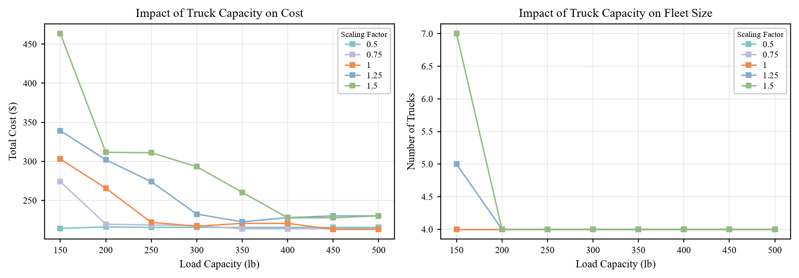
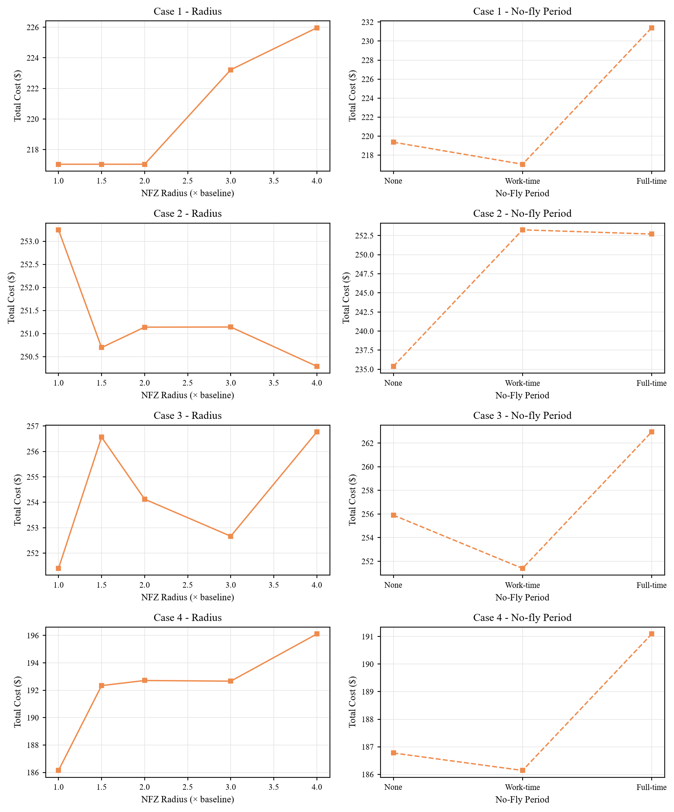
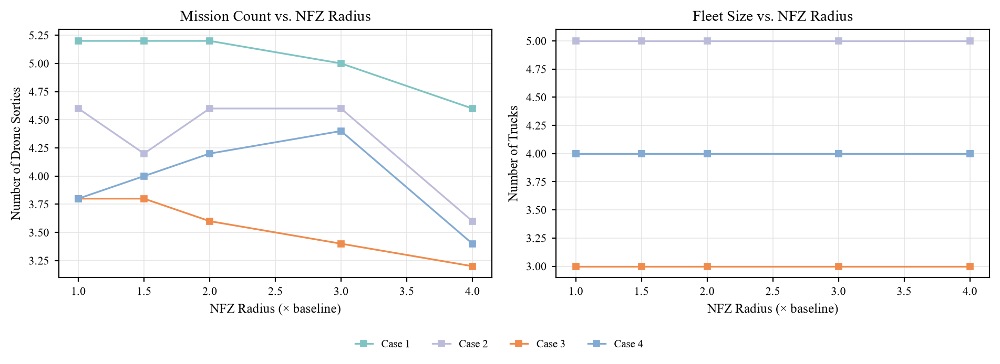

# 卡车-多无人机双向配送（含时空禁飞区）· 论文复现

> 复现对象：Zeng J., Hu Y., Pei M. (2026). *Optimizing bidirectional delivery with multiple drones and trucks: a mixed-integer nonlinear model to addressing no-fly zone constraints.* **Transportation Research Part E, 205, 104511.** DOI [`10.1016/j.tre.2025.104511`](https://doi.org/10.1016/j.tre.2025.104511)
>
> **独立复现**：模型、算法、实验全部依据公开论文与公开数据集自行实现，不含原作者代码。算例改造规则论文未公开，本项目自定（见 §5）。因此**趋势对齐、绝对数值不对齐**，本文所有结论都标注了口径。

**一句话结果**：16 个算例、ALNS 2000 轮 × 10 种子，**节省率 51.4%（论文 ≈52%）**；10 客户 4 个算例 **Gurobi 全部证到最优**（ALNS gap 0–1.22%）；100 客户 **CPU 124–187 s（论文 159–254 s）**；PSO 全面劣于 ALNS（+13.3%，论文同向）。**唯一差一个量级的是 Without-detour 列（0.5% vs 8.2%）**，已用算术上界证明是成本结构所致，不是实现缺陷。

---

## 1. 与论文的对齐度（先看这张表）

| 维度 | 论文 | 本项目 | 判断 |
|---|---|---|---|
| Saving%（初始解→ALNS） | 38.5 – 67.9，均值 ≈ 52 | **32.5 – 68.7，均值 51.4 / 中位 53.2** | ✅ 区间与均值都对得上 |
| 10 客户 vs 精确最优 | gap = 0 | **0 / 0 / 0.004 / 1.22%**（MILP 4/4 证最优） | ✅ 秒级达到 |
| ALNS 用时 | 100 客户 159–254 s | **124–187 s** | ✅ 同量级（Python 单线程评估器） |
| PSO 对照 | 全面劣于 ALNS，0 – 20.2% | **1.7 – 25.2%，均值 13.3%** | ✅ 方向与量级一致 |
| 相对 Truck-only | 4.4 – 54.1%，均值 20.8 | **6.5 – 40.4%，均值 15.8** | ◐ 方向对，上沿偏小 |
| 相对 Without-detour | 0 – 21.2%，均值 8.2 | **−1.2 – +2.6%，均值 0.5（配对 0.9）** | ✗ 差一个量级，已归因（§6） |
| Fig.9 容量–成本 | 150→300 lb 最陡，350 以上趋平 | **150→300 降 20.5–36.7%，300 以上趋平** | ◐ 拐点一致，我们「平」得更彻底 |
| Fig.10 载荷–续航 | 载荷↑ 成本↓，续航越长收益越大 | **0.9 kWh：5→12 lb 降 11.6%；0.6 kWh 仅 4.1%** | ✅ 交互方向一致 |
| Fig.11 时段 | 无 → 工作时段 → 全天，成本递增 | **全天 vs 无禁飞 +2.3 ~ +7.4%** | ◐ 方向对，幅度偏小 |
| Fig.11 半径 | 影响强于时段 | **1×→4× 仅 +2 ~ +5%** | ✗ 排序相反，已定位为时段覆盖率 |
| Fig.12 任务数 | 随半径**非单调** | **Case4：3.8→4.0→4.2→4.4→3.4** | ✅ 两种机制都复现 |

三类差距的完整清单见 §6，逐条证据见 `M6_对标结果.md`、`M7_灵敏度分析.md`、`Without-detour_幅度诊断.md`。

---

## 2. 问题与模型

每辆卡车配 1 架无人机，协同服务一批客户。每架次无人机从卡车出发、访问若干客户后回到卡车；
飞行途中卡车继续行驶。客户同时有**派件**与**取件**需求，卡车厢与无人机都有载荷上限；
无人机可在任意客户点起降；飞行需**绕开带时间窗的圆形禁飞区**。

目标（与论文 (2) 一致）：无人机能耗成本 + 卡车能耗成本 + 司机工时成本。

约束地图（79 条约束的逐条翻译见 `约束逐条翻译_2-79.md`）：

| 组 | 内容 | 本项目如何处理 |
|---|---|---|
| (13)–(15),(32),(34) | 禁飞区：航段不得穿越圆、绕行需走切线+圆弧 | `geometry.py` 解析计算绕行距离 |
| (22)(23)(31) | 卡车/无人机时刻递推、起降同步 | 逐路线模拟 |
| (35)–(38) | 客户时间窗 | 迟到判违约，**早到原地等待**（与推迟出发等价） |
| (39)–(43) | 能耗：卡车随载重、无人机随载重与续航 | `energy.py` |
| (52)–(73) | 载荷守恒（双向，含途中取放） | 到达时在机量递推 |
| 流守恒、唯一访问、起降须卡车在场、行驶中不许起飞 | | **由解的表示自动满足**，无需检查 |

> **一处有意偏离**：论文 (35) 字面禁止早到。我们允许早到原地等待——它与「推迟出发」等价，
> 不改变可行域，但省掉了为每个客户额外优化一个出发时刻。

---

## 3. 快速开始

```bash
python -m venv .venv
.venv/Scripts/activate                 # Windows（Linux/macOS: source .venv/bin/activate）
pip install -r requirements.txt

# 算例数据（83 MB，不入库）
git clone --depth 1 https://github.com/optimatorlab/mFSTSP.git data/raw/mFSTSP
python -m src.generator                # 生成 data/instances/set01..16.json（金标准，勿手改）

python -m scripts.reproduce --quick    # 冒烟：约 4 分钟，只验证链路
python -m scripts.reproduce            # 全量：约 1.5 小时（20 核）
```

`scripts.reproduce` 只是按顺序调用下表这些独立脚本，单步失败可照着打印出的命令重跑。

| 步骤 | 命令 | 产物 | 全量耗时 |
|---|---|---|---|
| 主实验 | `scripts.bench --exp main --seeds 10 --iters 2000 --refresh` | `results/bench_main.csv` | 15 min |
| 无绕行对照 | `scripts.bench --exp nodetour --no-detour ...` | `bench_nodetour.csv` | 17 min |
| 纯卡车对照 | `scripts.bench --exp truckonly --no-drone ...` | `bench_truckonly.csv` | 4 min |
| 参数消融 | `scripts.bench --exp ablate --no-tune --seeds 5 ...` | `bench_ablate.csv` | 10 min |
| PSO 对照 | `scripts.bench_pso --seeds 10 --iters 2000` | `bench_pso.csv` | 4 min |
| 汇总 | `scripts.summarize_bench` | `results/table3_v2.csv` / `.md` | 秒级 |
| 灵敏度 | `scripts.sensitivity --which all --refresh`（四组可并行） | `sens_*.csv` + Fig.9–12 | 5 min（并行） |
| 路线图 | `scripts.plot_routes --refresh` | `results/figs/routes_fig8.png` | 4 min |
| 精确解 | `scripts.run_milp` | `results/milp_check.csv` | 9 min |

Gurobi 需自备学术许可证，验证：`python -c "import gurobipy as gp; gp.Model(); print('ok')"`。
没有许可证时除 `run_milp` 与 4 项 `-m slow` 测试外，其余全部可跑。

---

## 4. 结果

### 4.1 Table 3（论文同口径：各种子取最优）

完整表见 [`results/table3_v2.md`](results/table3_v2.md)，列含义：`Saving` = 初始解→ALNS 的降幅，
`+%` = 该列成本相对 ALNS 成本的增加。

| Set | n | K | ALNS | Saving | CPU | Truck-only | +% | No-detour | +% | PSO | +% |
|---|---|---|---|---|---|---|---|---|---|---|---|
| 1 | 10 | 3 | 99.93 | 61.0% | 1.4s | 126.18 | 26.3 | 101.25 | 1.3 | 119.71 | 19.8 |
| 2 | 10 | 2 | 123.43 | 43.3% | 1.8s | 131.47 | 6.5 | 123.43 | 0.0 | 125.51 | 1.7 |
| 3 | 10 | 2 | 68.42 | 35.8% | 1.4s | 73.55 | 7.5 | 68.42 | 0.0 | 72.52 | 6.0 |
| 4 | 10 | 2 | 73.38 | 32.5% | 1.9s | 78.26 | 6.6 | 73.38 | 0.0 | 76.96 | 4.9 |
| 5 | 25 | 4 | 201.95 | 55.2% | 13.4s | 283.51 | 40.4 | 201.52 | −0.2 | 249.46 | 23.5 |
| 6 | 25 | 5 | 235.84 | 61.2% | 13.9s | 281.72 | 19.5 | 236.21 | 0.2 | 267.91 | 13.6 |
| 7 | 25 | 3 | 236.71 | 36.1% | 10.2s | 270.80 | 14.4 | 235.20 | −0.6 | 257.94 | 9.0 |
| 8 | 25 | 4 | 180.86 | 54.1% | 12.1s | 220.57 | 22.0 | 181.08 | 0.1 | 202.12 | 11.8 |
| 9 | 50 | 9 | 388.16 | 60.8% | 49.2s | 467.59 | 20.5 | 393.84 | 1.5 | 449.17 | 15.7 |
| 10 | 50 | 7 | 463.66 | 53.6% | 40.0s | 532.59 | 14.9 | 471.55 | 1.7 | 520.72 | 12.3 |
| 11 | 50 | 7 | 321.48 | 52.8% | 46.0s | 362.87 | 12.9 | 317.75 | −1.2 | 358.52 | 11.5 |
| 12 | 50 | 6 | 328.75 | 48.6% | 44.0s | 375.19 | 14.1 | 337.14 | 2.6 | 390.86 | 18.9 |
| 13 | 100 | 14 | 599.02 | 68.7% | 186.9s | 713.23 | 19.1 | 602.48 | 0.6 | 750.12 | 25.2 |
| 14 | 100 | 13 | 832.99 | 58.9% | 147.3s | 933.79 | 12.1 | 843.47 | 1.3 | 981.62 | 17.8 |
| 15 | 100 | 11 | 589.91 | 48.7% | 123.9s | 633.92 | 7.5 | 598.23 | 1.4 | 664.14 | 12.6 |
| 16 | 100 | 10 | 600.17 | 50.4% | 159.5s | 652.58 | 8.7 | 596.03 | −0.7 | 649.76 | 8.3 |

> 币值为自定成本系数下的相对量，**不与论文美元直接比**（§6.3）。种子间极差中位 4.7%，
> 所以所有单元格都是 10 个种子取最优、所有对照列都是 10 个种子取最优。

**同种子配对**（消除「取最优」的极值偏差）：Truck-only 15.85%、Without-detour 0.90%
（10/16 个算例为正）、PSO 14.42%、论文原参数 1.76%。报告里应优先用配对口径。

### 4.2 路线图

`python -m scripts.plot_routes --refresh` → 四个代表算例（10/25/50/100 客户）的卡车实线 + 无人机虚线：


图中标题的成本与上表逐格相同（求解口径一致：2000 轮 + 该算例达到最优的那个种子）。
图例按论文 Fig.8 的组织方式（每辆车两行：`Truck k` 实线 + 同色 `Drone k` 虚线），
挂在坐标区右侧框外以**不遮挡路线**；仓库用黑色小菱形。

### 4.3 灵敏度（Fig.9–12）

| | |
|---|---|
|  |  |
|  |  |


每点 5 个独立种子取均值——这不是可选做法：同一算例换种子的成本极差中位 4.7%，
而灵敏度要测的效应只有 2–7%，单种子曲线会给反向结论（实测过）。
数字与逐条讨论见 `M7_灵敏度分析.md`。

### 4.4 Gurobi 精确解

| Set | MILP 最优 | gap | MILP CPU | ALNS | 相对最优 |
|---|---|---|---|---|---|
| 1 | 98.724 | 0.00% | 254 s | 99.933 | +1.22% |
| 2 | 115.919 | 0.00% | 13 s | 115.919 | 0.00% |
| 3 | 67.765 | 0.00% | 18 s | 67.765 | 0.00% |
| 4 | 73.377 | 0.00% | 81 s | 73.380 | +0.004% |

MILP 不建模禁飞区（绕行距离是时间相关的分段距离，线性化代价过高），因此与 `disable_nfz` 的
ALNS 对照；每次求解都转回项目内的 `Solution` 用评估器复核目标值、里程、能耗、完工时刻四项。

---

## 5. 算例是怎么造出来的（论文未公开）

原始数据来自 Murray & Raj (2020) mFSTSP（Seattle / Buffalo），是**纯派件**的 VRPD 数据。
论文 §5 只说了「注入取件、时间窗、禁飞区」，**没给规则**。本项目自定并固化在
`configs/config.toml`（固定种子 `20261027 + set_id`）：

| 项 | 规则 | 说明 |
|---|---|---|
| 取件量 | `g_i ~ U(0, f_i)`，向上取整到 0.5 lb | 保证双向载荷不超无人机载荷 |
| 时间窗 | `e_i = 0.9·τ(depot→i) + U(0,3h)`，宽 `U(30,90)` min | 直接铺满首 1.7 h 会导致大面积不可行 |
| 禁飞区 | 数量 `clamp(round(n/8),2,8)`（10→2、50→6、100→8）；半径 **`U(600,1200)` m**；圆心 = 客户点偏移 `0.25–0.55r`；时段 = 班次开始后 1–2 h 起、持续 1.2–2.2 h | 见下方说明 |
| 车队规模 | `K = max(⌈Σf/Q⌉, 时间窗所需路线数)` | 只按容量会低估一半（Set1 容量只需 1 辆、时间窗需 3 辆） |

**为什么半径是 600–1200 m 而不是论文图示的 150–500 m**：按论文标度生成后，只有
3.7% 的航段需绕行、中位 12 m，Without-detour 对照组恒等于 0，绕行机制等于没复现出来。
放大到 600–1200 m 后绕行率 6.6%、中位 56 m，该列才有非零读数。
这是**有意偏离**，代价是绝对数值更不可能逐格对上。

---

## 6. 复现到什么程度（三类差距，性质完全不同）

| 类别 | 内容 | 能不能修 |
|---|---|---|
| **A 结构性** | 成本绝对值（论文 10 客户 13.25 vs 我们 99.93）、16 个算例与论文的映射、算例改造规则、PSO 粒子编码、Gurobi 的 NFZ 建模 | ❌ 论文未公开，只能声明 |
| **B 有意偏离** | NFZ 半径 600–1200 m、早到允许等待、载荷连续、`K` 的确定规则、ALNS 三处参数修正 | ⚠️ 已记录，是主动选择 |
| **C 实际差距** | Without-detour 幅度、Truck-only 上沿、Fig.11 半径排序 | ◐ 部分可修，部分是真差距 |

### 6.1 Without-detour：差的是量级，不是预算

补足预算后该列反而从 1.8% **降到 0.5%**（说明此前那点增益有一半是噪声）。真正的约束是成本结构：

```
无人机电费只占总成本的 0.1%（司机工时 68–79%、卡车油费 21–32%）
⇒ 绕行距离的全部价值 ≈ 总成本的 0.003%
```

绕行只能通过「航段不可飞 → 重排结构 → 卡车多跑/司机多等」间接起作用，而我们的客户密度
让替代锚点几乎总是存在（禁绕后无人机服务客户平均只少 0.5 个）。四组诊断实验里最有效的是
**把禁飞圆从「压在客户点上」改成「夹在两客户之间」**，可把该列从 2.7% 抬到 4.1%（单种子诊断，
最大 10%），仍差一倍，且要重造全部算例、偏离论文 Fig.8 的图示，因此没采用。
**可比指标是「绕行依赖度」**：论文 47%，我们 3–6%。证据链：`Without-detour_幅度诊断.md`。

**顺带一个反例**：硬约束 `cost*(禁绕) ≤ cost*(纯卡车)` 我们 16/16 满足，**论文 15/16**
（Set16 违反）——说明论文该列本身含 ±1–5% 的搜索噪声，不适合当逐格对标目标。

### 6.2 Truck-only 上沿 40.4% vs 54.1%

方向一致、幅度不足。一半在算例（客户分布更均匀，卡车本来跑得不算太差），一半在
`K` 由时间窗主导导致车队偏大、卡车侧成本基数偏高。

### 6.3 成本系数是自定的

`e_drone / b / e_truck / c_drone / c_truck / c_customer` 论文只给符号不给值。
本项目按物理量级取值（无人机空载航程 ≈ 31 km），所以**只有 Saving% 与 Increasing% 可比**。

---

## 7. 实现要点

### 7.1 解的表示与「免检」约束

```
Solution ── Route(nodes=[0, c…, 0], sorties=[Sortie(launch, recover, customers)]) ── 每车一解
```

`launch`/`recover` 存的是**位置下标**（因为架次锚定在卡车路径的相邻两节点之间），
但算子内部一律先转成**节点编号**（`route_to_specs` / `route_from_specs`）——下标会随增删平移，
是这类模型最常见的 bug 来源（本项目踩过两次，见 `M8_复现评估与改进方向.md`）。

由此，**流守恒、客户唯一访问、起降须卡车在场、行驶中不许起飞**这四类约束由结构自动满足；
需要显式检查的只有：时刻递推、时间窗、能耗、载荷、禁飞。

### 7.2 评估器的两条硬规则（漏了会显著低估成本）

| 规则 | 为什么必须有 |
|---|---|
| **架次不能重叠**（`DRONE_BUSY`） | 每车只配一架无人机。漏检时两个架次「同时各飞各的」，成本低估十几个百分点，ALNS 会主动去找这种非法解（曾经算出比 MILP 最优还低的成本） |
| **同一节点不能既回收又起飞**（`LR_SAME_NODE`） | 论文只有一个 `w_i`，同点连续起降会让时刻递推 (23) 拿卡车到达时刻当起飞基准，模型内部不自洽 |

### 7.3 禁飞区几何

圆形禁飞区之间可能相交，绕行最短路径是「切线 + 圆弧 + 切线」，需要在可见性图上求最短路。
`geometry.py` 解析计算，并按**飞行时刻**判断航段是否处于禁飞窗口内——
绕行量 `d_ijh` 是**纯几何量、与时间无关**，所以全量预计算（这是 4.6× 提速的一半来源，见 §8）。

### 7.4 ALNS

| 项 | 做法 |
|---|---|
| 破坏算子（4） | `random` 随机移除 · `worst` 最差移除 · `related` 相关簇移除 · `shuffle` 整条路线打散重排 |
| 修复算子（4） | `random` 随机顺序插入 · `truck` 卡车直服优先 · `drone` 无人机架次优先 · `equal` 两条通道均衡 |
| 接受准则 | 模拟退火，`T0` 按「中位上升步接受率 50%」标定，`α=(1e-3)^(1/iters)` |
| 停滞处理 | **随机移除 50% 再插回并抬温**（论文是回退到最优，只是回到同一吸引域） |
| 破坏率 | 每轮 `U(10%, 40%)`（论文固定 30%，100 客户时接近「重建半张图」） |
| 权重 | 自适应，下限 0.05 防算子饿死 |

三处参数修正是**主动偏离论文**，消融显示平均改善 **1.76%**（配对 5 种子，12/16 个算例为正）；
`--no-tune` 可复原论文原参数。

### 7.5 一个必须说清的坑：取最优 vs 配对

10 个种子取最优是最小值，两个最小值相减会放大噪声。所以：

- **Table 3 逐格对标**用「取最优」（与论文同口径）；
- **结论性数字**用「同种子配对」（`summarize_bench` 两列都输出）。

---

## 8. 工程

| 项 | 数值/做法 |
|---|---|
| 代码量 | `src/` 3 690 行、`scripts/` 2 485 行、`tests/` 1 435 行 |
| 测试 | **205 项**（201 快 + 4 需 Gurobi，`pytest.ini` 用 `slow` 标记）；`python -m pytest -q` 约 3.4 s |
| 金标准算例 | `data/instances/*.json` 是基准，改了生成器会有测试立刻失败并打印第一处差异 |
| 结果守门 | `scripts/golden_check`：同种子必须**逐位复现**基线（ALNS 确定性），性能改动不许变结果 |
| 并行 | `bench.py` / `bench_pso.py` 多进程 + **逐行落盘可续跑**（按 `set+seed+iters` 去重） |
| 提速 | **4.6×**（Set13 370 → 81 ms/轮），结果逐位不变。核心是绕过行量的预计算 + 缓存 |
| 可视化 | `src/style.py` 统一配色（从论文 PDF 提取），图内文字全英文、浅灰网格、图例挂框外 |

**为什么非要提速**：论文报 100 客户 159–254 s，要在同样量级上逐格对标，Python 评估器就必须追平
他们的编译型实现。这也是「10 种子 × 16 算例 × 4 组对照（560 次求解）」能在 1 小时内跑完、
从而做得起全量重跑与 5 种子灵敏度扫描的前提。

---

## 9. 目录

```
configs/      config.toml（模型与生成参数）、instances.toml（16 个算例的元数据）
data/raw/     原始 mFSTSP 数据（git 忽略）
data/instances/  16 个金标准算例（JSON，入库）
src/          instance · io · generator · geometry · distance · energy · solution
              evaluator · initial · operators · alns · cache · milp · pso
              visualizer · style
scripts/      bench · bench_pso · summarize_bench · reproduce · sensitivity
              plot_routes · run_milp · diag_detour · probe_detour · probe_placement
              golden_check · check_geometry · build_docs · style_preview
              （旧）run_alns · run_pso：第一版两列对照，已被 bench / bench_pso 取代
tests/        13 个测试文件，205 项
results/      bench_*.csv · sens_*.csv · table3_v2.csv/.md · milp_check.csv
results/figs/ routes_fig8.png · fig9–12 · set01–16_network.png
results/archive/  2026-11-02 那批旧结果（修复架次完整性校验之前），仅供对照
```

文档索引：

| 文件 | 内容 |
|---|---|
| `M0_论文要点笔记.md` | 论文的问题、符号、约束地图、算法与参数 |
| `M6_对标结果.md` | Table 3 三列对照、Gurobi 验证、口径差异 |
| `M7_灵敏度分析.md` | Fig.9–12 复刻结果与三处不一致 |
| `M8_复现评估与改进方向.md` | 对齐/未对齐清单（按可修性分类）、性能剖析、ML 方向取舍 |
| `M8_执行记录_提速与论文协议.md` | 4.6× 提速、2000 轮 × 10 种子、全量重跑记录 |
| `Without-detour_幅度诊断.md` | 该列 0.5% vs 8.2% 的完整归因 |
| `约束逐条翻译_2-79.md` / `.html` | 79 条约束逐条公式 + 直译 + 启发式如何处理 |

---

## 10. 已知局限与后续

1. **Without-detour / Truck-only 上沿**：根因已量化（成本结构与算例经济学），除非改算例改造规则，
   否则修不动。已在文档里给出可复算的证据链，不做「凑数」。
2. **PSO 编码自造**：random-key 编码对 key 扰动不敏感，是它系统性劣于 ALNS 的一部分原因；
   论文未给编码，这一列只能当「同预算的另一个元启发式」参考。
3. **MILP 不含禁飞区**：绕行距离的线性化需要 z/q 与 McCormick 四式，超出复现范围。
4. **可做的改进**（未实施）：CI 加一致性判据 `nodetour ≥ alns`（违反即说明未收敛）；
   补三个邻域（路线消除 / 架次内 2-opt / 锚点平移）；受限算例的初温下限；
   用案例检索热启动（详见 `M8_复现评估与改进方向.md` §4–6）。

---

## 11. 引用与许可

```bibtex
@article{zeng2026bidirectional,
  title   = {Optimizing bidirectional delivery with multiple drones and trucks:
             a mixed-integer nonlinear model to addressing no-fly zone constraints},
  author  = {Zeng, J. and Hu, Y. and Pei, M.},
  journal = {Transportation Research Part E: Logistics and Transportation Review},
  volume  = {205},
  pages   = {104511},
  year    = {2026},
  doi     = {10.1016/j.tre.2025.104511}
}
```

本仓库不含论文原文（Elsevier 版权）。算例原始数据版权归 Murray & Raj (2020) 作者，遵循其仓库条款。
项目代码为个人复现作品，供学习与交流参考；引用请注明本仓库与原文。
