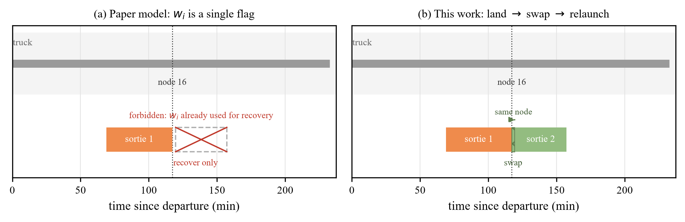
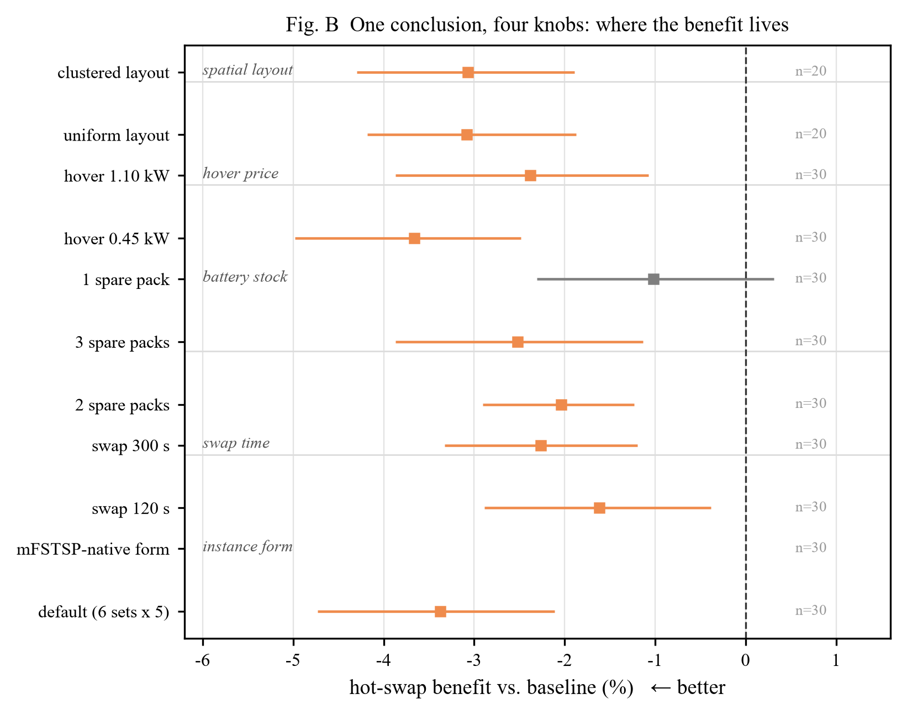
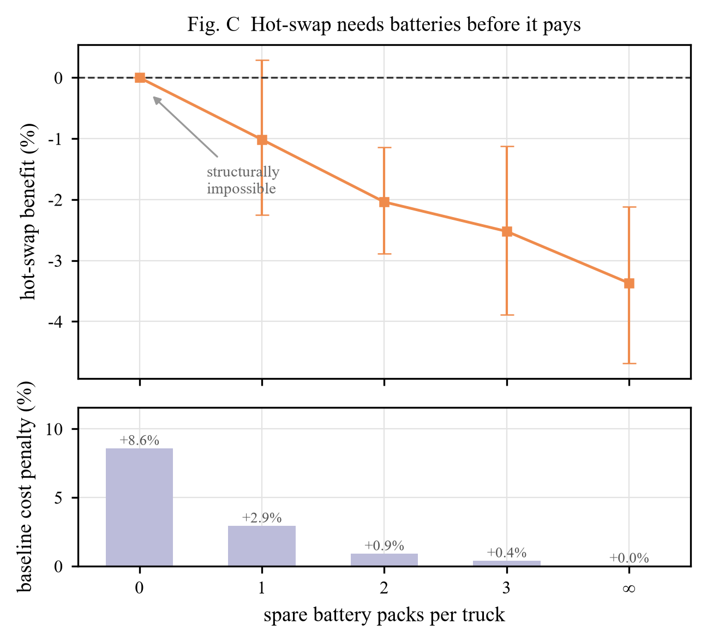
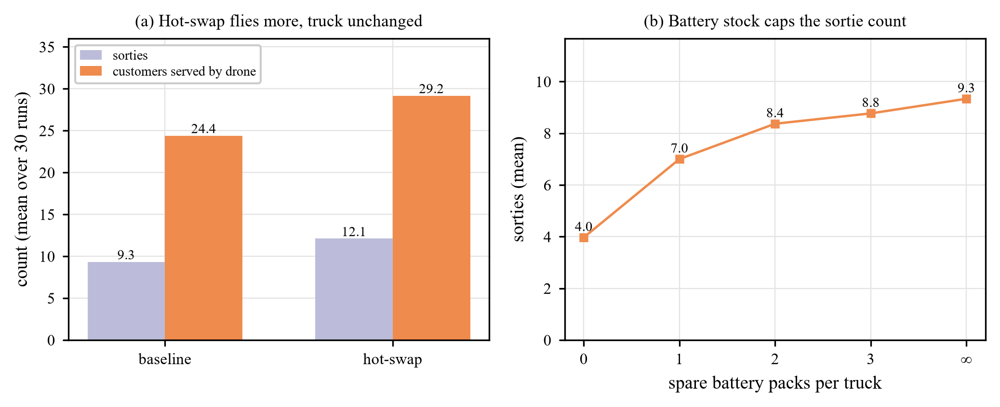

# TDDO 成果报告

> 本报告把 25 份设计与分析笔记压成一页可读的成果：做了什么、得到了什么、边界在哪。
> 细节一律给出处；所有数字都能在 `results/` 里复算。

---

## 摘要

一个卡车-无人机联合配送优化器（TDDO）：混合整数规划建模（79 条约束、七族），
自适应大邻域搜索求解，Gurobi 精确解定标与定级。

在 16 个基准算例 × 10 个种子上：**相对纯卡车方案成本低 15.9%**、**相对初始可行解再降 51.4%**、
**100 客户 124–187 s**、**10 客户 4/4 证到 gap 0%**。

项目后半程的落点不是"再降 0.5 个点"，而是**一个模型改进 + 它的边界**：
把标准建模里那个"兼任降落与起飞"的 0-1 变量拆开，同节点换电可以降本 **1.5%–3.4%**，
并且这个数随四个设定漂移（图 B）——所以对外报区间，不报点值。

| 变量 | 取值 | 换电收益 |
|---|---|---|
| 基准（电池管够、换电免费、悬停免费） | — | **−3.37%** |
| 换电要 2 分钟 | 120 s | −1.62% |
| 换电要 5 分钟 | 300 s | −2.26% |
| 每车只带 3 块备用电池 | b=3 | −2.52% |
| 每车只带 2 块 | b=2 | −2.04% |
| 每车只带 1 块 | b=1 | −1.02%（不显著） |
| 一块都不带 | b=0 | **0.00%（换电结构上无从发生）** |
| 悬停按 1.10 kW 计电 | — | −2.38% |
| 纯派送形态（无取件/无禁飞区/宽窗） | — | −4.29% |
| 客户聚簇 | 最近邻距离 −50% | −3.07% |

> 除"全量 16×10"之外的百分比，统一取 **6 算例 × 5 种子的 30 个配对**（§5.1 说明两个样本的差别）。

---

## 1. 四张图

### 图 A · 缺陷长什么样



一条真实卡车路线（Set 5，4 个架次）。无人机在节点 16 落地之后，**同一节点立刻再起飞**是最优解的
一部分；但如果用单个 0-1 变量表示"降落/起飞"，两件事同时发生时时刻递推会拿卡车到达时刻当起飞基准
（此时机还没落地），模型内部就不自洽。所以标准写法用 `wl + wr ≤ 1` 把这种情况禁掉了。

### 图 B · 一个结论，四把刀



11 个条件、全部同种子配对、95% bootstrap 区间。**跨零的只有"1 块备用电池"那一行**——
其余所有设定下换电都仍然更好，但幅度在 −1.0% 到 −4.3% 之间。

### 图 C · 换电要先有电池



上半：换电收益 vs 每车备用电池数，曲线在 b=3 仍未饱和；下半：同样的电池配置下，
基准臂自己贵了多少（b=0 时 +8.6%，因为无人机一趟只能飞一次）。
**b=0 时换电收益恰好是 0.00%，30 个配对逐位相同**——不是变差，是这件事无从发生。

### 图 D · 机制在结构上



换电不改变卡车数量，它把架次数从 9.3 抬到 12.1、无人机服务的客户从 24.4 抬到 29.2；
右图说明架次数被电池数直接卡住（4.0 → 9.3）。**这是"建模限制"的正面用法：
限制是人为的，放开它等于同一批卡车运更多货。**

---

## 2. 模型：一条基线与六个开关

基线是 79 条约束、七族（路由 / 架次耦合 / 时间同步 / 时间窗 / 载荷 / 能量 / 空域），
目标 = 无人机电费 + 卡车油费 + 司机工时。

| # | 常规设定 | 本项目 | 开关（默认关） | 依据 |
|---|---|---|---|---|
| 1 | 一车一机 | 一车 m 机同时在飞 | `fleet.drones_per_truck` | 车顶挂架能放几架 |
| 2 | 单变量：同节点只能起飞**或**回收 | 可先降落、换电、再起飞 | `fleet.allow_hotswap` | 换电池是常规作业 |
| 3 | 新建架次只能跨相邻两节点 | 可跨 d 段卡车路径 | `operators.SORTIE_SPAN` | 无人机可以去远处 |
| 4 | 悬停零成本零耗电 | 可按功率计电并进 SOC | `energy.hover_power_kw` | 能耗只算飞行距离会低估 |
| 5 | 无限电池、零重量 | 每车 b 块备用，重量占载重 | `fleet.spare_batteries` | 车顶就那么大 |
| 6 | 换电不耗时 | 同节点接力时卡车等 `swap_s` | `fleet.swap_s` | 整包快拆约 2 min |

六条都做成开关而不是改默认值，原因是**默认路径必须可回归**——
`scripts.golden_check` 用 5 个固定配置做逐位回归，任何默认路径的改动都会被它拦下。

模型层面还有 `src/milp_hs.py`：把 `Td` / `fa,ga` / `E` 各自拆成"到达/出发"两套，
让同一个节点可以既降落又起飞。加回 `wl+wr ≤ 1` 时，4 个算例的最优值与单变量形式**逐位相同**
（等价性闸门）；放开后**全部严格下降且 gap 0%**（有效性闸门）。

---

## 3. 算法：骨架没动，可行域变了

| 部件 | 选择 |
|---|---|
| 4 个破坏算子 | random / worst / related / shuffle |
| 4 个修复算子 | random / truck / drone / equal |
| 接受准则 | 模拟退火，T0 按算例标定 |
| 算子权重 | 四档加分 + 0.05 下限 |
| 评估器 | m 架集合 + 换电/悬停/电池/换电耗时四类判定 |
| 邻域 | 相邻锚点，可跨 d 段 |

**这套搜索的收益来自算子配比，不来自"更聪明的选择"**——这一点决定了后面那串负结果（§6）。

---

## 4. 求解质量

| 指标 | 数值 |
|---|---|
| 相对纯卡车方案 | 成本低 **15.9%**（同种子配对） |
| 相对初始可行解 | 再降 **51.4%** |
| 100 客户单次求解 | **124–187 s** |
| 10 客户精确解 | **4/4 gap 0%**；ALNS 距离最优 0–1.22% |
| 禁飞区绕行的代价 | +0.5%（成本由司机工时主导） |
| 车队配置结论 | m=2 的第二架机净贡献仅 **0.68%**；多买一辆车反而 +0.67% |

---

## 5. 换电：三条证据

### 5.1 统计证据

16 算例 × 10 种子同种子配对：**−2.26%**（140 好 / 20 差，p = 6.4e-18）；
6 算例 × 5 种子子集：**−3.37%**（26/4，p = 6.0e-05）。两个数样本不同，报告时要写清。

### 5.2 最优性证据（关键）

把换电解固定进单变量形式，用 Gurobi 判：四个算例的已证明最优全部被改写。

| Set | 单变量形式最优 | 拆分形式解 | 降幅 | 唯一违反的约束 |
|---|---|---|---|---|
| 1 | 98.7240 | 94.4471 | −4.33% | `lr_once` |
| 2 | 115.9189 | 115.2679 | −0.56% | `lr_once` |
| 3 | 67.7647 | 67.6454 | −0.18% | `lr_once` |
| 4 | 73.3771 | 73.2560 | −0.17% | `lr_once` |

拆分形式自己也能解出这四个值，gap 0%——所以这不是"外部喂解"，而是**模型内部可达**的最优值。

### 5.3 它稳吗

| 检验 | 结果 | 判定 |
|---|---|---|
| 生成参数四组扰动 | −3.33% / −4.22% / −4.30% / −5.39% | 稳 |
| 纯派送形态（无取件/无禁飞区/宽窗） | −4.29%（27/30） | 稳 |
| 悬停计电（0.45 / 1.10 kW） | −3.66% / −2.38% | 稳 |
| 客户聚簇 | −3.07%（vs 均匀 −3.08%） | 稳 |
| 换电耗时 120 / 300 s | −1.62% / −2.26% | 变弱，但方向不变 |
| 每车 1 / 2 / 3 块电池 | −1.02% / −2.04% / −2.52% | 门槛在 2 块 |

**对外表述：同节点换电降本 1.5%–3.4%，前提是每车 ≥2 块备用电池、换电不超过 5 分钟。**

---

## 6. 没成立的东西（同等重要）

| 路线 | 结果 | 被否的机制 |
|---|---|---|
| 候选预筛（LightGBM） | 评估 −87.6%，**墙钟 2.1×** | 评估器已到 ~30 µs，打分开销与省下的同量级 |
| 即时成功率选算子 | 固定最高成功率 → **+17.18%** | 成功率 ≠ 价值 |
| UCB / DQN 选算子 | +3.97% / +3.78% | 把 `equal` 修复的份额压没了 |
| LLM 造禁飞区算子（7 个） | 6 输给随机，1 打平 | 破坏算子的职责是多样性 |
| 运行时规则干预 | −1.74%（零智能对照 0%） | 懂行的规则有害 |
| 跨段锚点（`SORTIE_SPAN`） | 免费 −2.40% → **计电 −0.62%（p=0.58）** | 收益靠"免费悬停" |
| 锚点平移局部搜索 | +0.62% | 邻域已被修复算子覆盖 |

一条共同结论：**这套 ALNS 的收益来自算子配比，不来自决策智能。**

---

## 7. 交付物与规模

| 类别 | 内容 |
|---|---|
| 代码 | `src/` 5 801 行 26 模块（ALNS / 评估器 / 几何 / 能耗 / MILP / 多机 / 换电） |
| 脚本 | `scripts/` 6 047 行 37 个（实验、诊断、出图、算例构建、敏感性总表、自检） |
| 测试 | **292 项**（282 快 + 10 Gurobi），`golden_check` 逐位回归 |
| 结果 | 60 份 bench CSV（3 402 次 ALNS 求解）+ MILP 8 次 + 灵敏度 700 次 + 图 30 张 |
| 文档 | 项目书 / 成果报告 / 工程手册 / 求职材料 + 设计笔记 25 份 + 分析笔记 4 份 |

---

## 8. 一键运行与产物

```bash
python -m scripts.reproduce          # 全量约 1.6 h（结果表 + 图 + 敏感性）
python -m scripts.reproduce --quick  # 4 分钟冒烟，不覆盖主结果
python -m scripts.paper_figs         # 本报告的四张图（图 A 现场求解约 15 s）
python -m scripts.robustness         # 三组单参数敏感性总表
pytest -q -m "not slow"              # 282 项快速测试
```

---

## 9. 局限

1. **算例自建**：需求/时间窗/禁飞区/车队规模按固定规则生成，只比趋势不比绝对金额。
2. **MILP 不含禁飞区、不含悬停**：§5.2 的最优性在"悬停免费"口径内成立。
3. **规模上限 100 客户**：无 200+ 外推。
4. **换电耗时的斜率测不准**：120 与 300 s 差 0.69%（p=0.59），只能给区间不能给曲线。
5. **单参数敏感性 ≠ 联合敏感性**：四把刀各自测过，**没有做"一起上"的组合**，
   叠加后的数值不能由本文外推。
