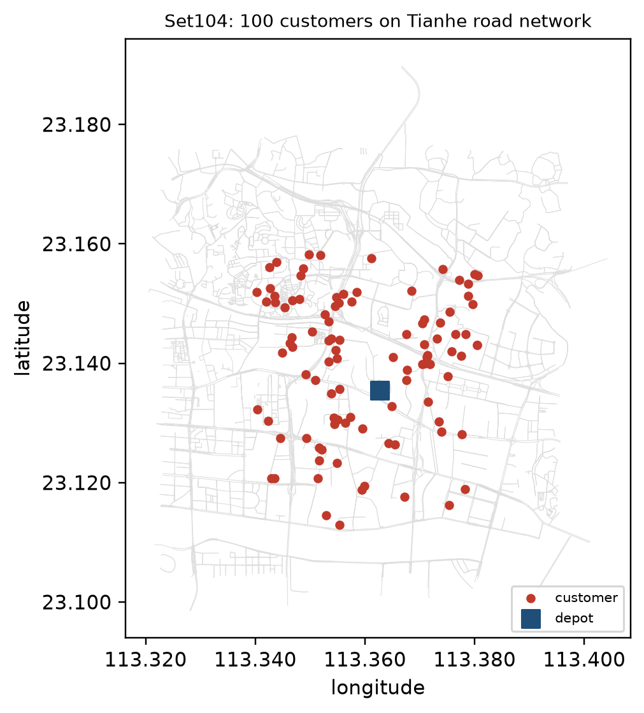

# M9.23 · 天河真实路网算例：把西雅图算例搬到广州

> **做了什么**
>
> 把西雅图的 4 个算例（10 / 25 / 50 / 100 客户）等比缩放搬到广州天河，卡车距离与时间
> 换成天河 OSM 路网的最短路（有向、含单行线），无人机仍是欧氏距离。产出 4 个新算例
> `set101`–`set104`，下游（生成器、评估器、MILP、ALNS、全部脚本）**一行未改**。
>
> 一个直接观察：天河的卡车绕行倍数是 **1.68–1.95**，西雅图是 **1.40**。
> 同样的相对布局，天河的路网让卡车多绕 20%–40%，无人机的相对优势因此更大。

---

## 1. 为什么不是"换个距离矩阵"

原始算例的节点是西雅图的真实经纬度（Set1 的 depot 在 `47.566, -122.289`）。高德/腾讯的
驾车距离接口只服务国内坐标，直接拿西雅图坐标去查天河路网没有意义。

所以做了三件事：**等比缩放 → 平移到天河 → 吸附到最近路口**。相对几何（谁离谁近、
depot 居中还是偏边）保持不变，变的只有尺度和路网——这样新旧算例还能横向比较。

代码层面顺的原因是：`truck_dist_m` / `truck_time_s` 本来就是独立的**有向矩阵**，
卡车距离只从矩阵读、从不从坐标反算；无人机走 `drone_dist_m()`，与卡车矩阵解耦。

## 2. 方法

| 步骤 | 做法 |
|---|---|
| 取路网 | OSM 主 API（`api.openstreetmap.org/api/0.6/map`），天河核心区 5×5 格，每格约 1.4 km |
| 建图 | 节点 = OSM 路口；边 = 相邻节点，长度 haversine；只保留强连通分量最大的一块（82% 的节点） |
| 方向 | 按 OSM `oneway` / `junction=roundabout` 生成有向边；掉头、单行线都体现在矩阵里 |
| 时间 | 边权 = 长度 / (等级限速 × 0.85)。限速表：快速路 80、主干 50、次干 40、支路 35、小区路 25 km/h |
| 变换 | 4 个源算例各自等比缩放（客户群对角线 → 6.5 km），平移到 `23.140, 113.360` 附近 |
| 吸附 | 每个点到最近的路口，取 8 个候选里未被占用的那个；平均偏移 61–80 m，最大 339 m |
| 矩阵 | 从吸附后的节点跑 Dijkstra，距离与时间各一遍；平行边按最短的取（否则会被求和成两倍长） |

区域：`23.105–23.175 N, 113.325–113.395 E`，约 7.8 × 7.1 km，覆盖体育中心、珠江新城、员村一带。
路网规模：3 470 条 way、30 363 条有向边。

## 3. 产出

| 新算例 | 源算例 | 客户 | 跨度 | 卡车距离中位 | 最大 | 吸附均值 / 最大 |
|---|---|---|---|---|---|---|
| set101 | Set1 | 10 | 6.5 km | 5.31 km | 10.4 km | 61 / 294 m |
| set102 | Set5 | 25 | 6.5 km | 5.18 km | 9.2 km | 80 / 270 m |
| set103 | Set9 | 50 | 6.5 km | 4.86 km | — | 71 / 275 m |
| set104 | Set13 | 100 | 6.5 km | 4.81 km | 11.2 km | 77 / 339 m |
| set112 | Set5 | 25 | 6.6 km | 5.34 km | 9.4 km | 80 / 270 m（高德矩阵） |
| set111 / 113 / 114 | Set1 / 9 / 13 | 10 / 50 / 100 | 6.5 km | — | — | 同 set101/103/104（仅换矩阵） |

注意“跨度 6.5 km、距离中位 5 km、最大 11 km”：两点直线 6.5 km，开车要 11 km，这就是
天河的路网——珠江与快速路把城市切成块，绕行是常态。



*图：set104 的 100 个客户与 depot 落在天河路网上（灰线为 OSM 路网，底图为 5×5 格拼合）。
depot 在体育中心附近，客户群向西南铺开约 4 km。*

## 4. 五项体检

| 检查 | 结果 | 判断 |
|---|---|---|
| 连通性 | 无 NaN / inf | 通过（只保留最大强连通分量，避免不可达） |
| 三角不等式 | 抽样 3 000 组，**100%** 通过 | 通过（若不过说明矩阵拼接错位） |
| 对称偏差 | 中位 **18%–20%** | 合理：单行线 + 单向匝道。接近 0 反而要怀疑被对称化 |
| 卡车 ÷ 无人机 | **1.68 / 1.88 / 1.84 / 1.95** | 合理（西雅图同指标是 1.40） |
| 对角为零 | 全部为 0 | 通过 |

`scripts/build_tianhe.py --step check` 会把这张表重算一遍。

## 5. 与西雅图算例的差别（也是唯一的可比性说明）

| 维度 | 西雅图 | 天河 |
|---|---|---|
| 客户群跨度 | 18.7–34.9 km | 6.5 km（等比缩放） |
| 卡车绕行倍数 | 1.40 | **1.68–1.95** |
| OD 距离中位 | 13–18 km | 4.8–5.3 km |
| 路网方向性 | 有向（OSM/pgRouting） | 有向（OSM，含单行线） |
| 无人机 | 欧氏 + 禁飞区绕行 | 同左，口径不变 |

**为什么绕行倍数重要**：无人机按直线飞，卡车按路网走，倍数就是“无人机省多少路”的粗指标。
天河比西雅图高 20%–40%，意味着在同一套目标函数下，无人机相对卡车更划算。
这是**观察**，不是结论——真要说得靠跑，且换电那条结论（1.5%–3.4%）必须在天河重跑，
不能平移。

## 6. 冒烟结果（只证明链路通，不作结论）

600 轮、3 个算例 × 2 种子，共 6 次求解，0.4 min：

| 算例 | 初始解 | 最优 | 节省率 | 架次 |
|---|---|---|---|---|
| 101 | 165.56 | 90.85 | 45.1% | 2 |
| 102 | 266.58 | 118.01–118.88 | 55.4%–55.7% | 5 |
| 103 | 453.10 | 270.37–281.35 | 37.9%–40.3% | 6 |

节省率与西雅图同量级（30%–60%），说明算例构造没有把问题变得平凡或不可行。
600 轮远未收敛，不能用于任何比较。

## 7. 高德交叉校验（Key 已可用）

拿到 Web 服务 Key 之后做了两件事：**抽样校验**与**高德矩阵变体**。Key 放在项目根目录的
`.env`（模板 `.env.example`），由 `src/env.py` 读取——代码里没有任何明文 Key，`.env` 在
`.gitignore` 里。优先级是「进程环境变量 > `.env`」，所以临时换 Key 不必改文件。

### 7.1 抽样校验：长距离一致，短距离不可比

set13 的 101 个节点，每 10 个取一个终点（11 个终点 × 100 个起点 = 1 100 个 OD），
坐标系先做 WGS-84 → GCJ-02 转换：

| OSM 距离档 | 样本 | 高德 ÷ OSM 中位 | P10 – P90 |
|---|---|---|---|
| 5–8 km | 418 | **1.03** | 0.65 – 1.60 |
| 3–5 km | 417 | 1.15 | 0.67 – 1.86 |
| 1–3 km | 228 | 1.40 | 0.88 – 2.54 |
| 0.3–1 km | 27 | 1.54 | 0.72 – 6.27 |
| < 0.3 km | 6 | **14.8** | 3.4 – 70.5 |

两个读法：

1. **长距离上两家是一致的**（5 km 以上中位差 3%），说明 OSM 路网用于**路径优化**是够的。
2. **短距离完全不可比**：OSM 说 12 m，高德说 914 m——因为两个点被吸附到同一条路上的相邻路口，
   而高德按「门牌级起终点」算，要绕单行线。这类差异不是路网错，是**语义不同**。

另一个值得记的点：**只有 27% 的 OD 落在 ±10% 内**，尾部很宽（P10 0.65、P90 1.60）。
所以「中位一致」不等于「可以随便互换」——换成高德会改变个别 OD 的相对远近，进而改变解的结构。

时间上差得更多：高德中位 **16.3 min**，OSM（自由流 ÷ 0.85）**8.8 min**，比值 **1.84**。
抓取时间是周六 15:20，天河正是拥堵时段；也就是说 `SPEED_FACTOR = 0.85` 对真实交通偏乐观。

### 7.2 高德矩阵变体：四个规模都建了

同布局、同种子，只把卡车矩阵换成高德（v3/distance，2026-11-21 15:2x 抓取，含该时段路况）：

| 规模 | OSM 集 / 高德集 | 车队 | 司机工时 (h) | 成本 | 变化 |
|---|---|---|---|---|---|
| 10 | set101 / **set111** | 2 / 2 | 3.45 / 3.52 | 90.64 / 94.17 | **+3.9%** |
| 25 | set102 / **set112** | 4 / 6 | 4.05 / 5.76 | 112.60 / 154.32 | **+37.1%** |
| 50 | set103 / **set113** | 5 / 7 | 9.93 / 9.96 | 266.99 / 270.89 | **+1.5%** |
| 100 | set104 / **set114** | 7 / 13 | 11.46 / 16.97 | 329.10 / 448.80 | **+36.4%** |

（每格是 10 个种子的均值，2 000 轮。）

机制是同一个：**高德的时间中位是本项目自由流口径的 1.84 倍**（16.3 vs 8.8 min），
时间窗因此更紧，25 与 100 客户两个规模各多要 2 辆和 6 辆车，司机工时 +42% / +48%，
成本跟着涨三成多。

**50 客户那个 +1.5% 值得单独说**：初始成本涨了 33%，但司机工时几乎没变（9.93 → 9.96 h），
说明 OSM 版本在这个规模上本来就"开着 5 辆车磨时间"，换成更慢的路网后靠重排路线吸收了，
不需要加车。所以**成本涨幅不是路网的单调函数，而是"车够不够"的函数**——这条比"高德更贵"
更有信息量，也是把两种数据源并排跑的价值所在。

注意：这些数字**不能**当作"真实城市成本"来引用——高德矩阵是某一天下午的路况快照，
可复现性为零；它只回答"换一套时间口径，结论往哪边动"。

### 7.3 所以默认仍用 OSM

| 理由 | 说明 |
|---|---|
| 可复现 | 高德含实时路况，官方文档明写不同时间结果不同；OSM + Dijkstra 是确定的 |
| 可解释 | 距离与时间都来自同一张图，改一个参数（`SPEED_FACTOR`）能说清影响 |
| 成本 | 一个 101 节点算例约 202 次请求，4 个算例近千次；免费额度够但不适合反复重建 |

高德版本留在仓库里（`set112` + `base_set05_amap.json`），用途是**对照**：如果哪天要主张
「真实城市下收益是多少」，应该报两个口径并说明差别，而不是只挑一个。

## 8. 局限

1. **缩放会改变尺度**。客户群从 18.7–34.9 km 压到 6.5 km，虽然相对几何不变，
   但时间窗密度、架次覆盖范围都跟着变。要做“原尺度天河”，得用更大的路网范围。
2. **吸附最大 339 m**。个别客户点落在路口之间，被挪到了最近路口；对 6.5 km 的算例影响约 5%。
3. **禁飞区仍是合成圆**。天河真实的空域限制（机场净空、临时管制）没有建模，也没有数据源。
4. **速度是假设**。等级限速 × 0.85 是平峰近似，没有红绿灯配时、没有潮汐车道、没有货车限行。
5. **不与旧结论横比**。15.9%、1.5%–3.4% 这些数字都在西雅图算例上得到，天河要重跑才有。
6. 只做了 4 个算例（每个规模 1 个），没有“大城/小城 × depot 居中/边缘”的配对设计。

## 9. 复现

```bash
python -m scripts.build_tianhe --step fetch    # 25 格，约 1.5 min（可断点续跑）
python -m scripts.build_tianhe --step build    # 建图 + 生成 set101–104
python -m scripts.build_tianhe --step check    # 五项体检
python -m scripts.build_tianhe --step plot     # 出图（results/figs/tianhe_set104.png）

# 高德变体与交叉校验（Key 从 .env 读，见 README §5.1）
python -m scripts.build_tianhe --step build --only 5 --matrix amap   # → set112
python -m scripts.amap_check --base set13 --every 10                 # 1100 个 OD 对照

python -m scripts.bench --exp tianhe --sets 101,102,103,104 --seeds 10 --iters 2000
```

`data/tianhe/tiles/`（40 MB 原始抓取）不入库，`data/tianhe/base_*.json`（矩阵）与
`data/instances/set1xx.json` 入库，所以 clone 下来不联网也能跑。

## 10. 可视化：把解画在高德底图上

`scripts/export_web.py` 只做项目特有的部分：求解 → 真实路网折线 → 解数据；渲染统一交给
`amap/` 可视化模块（`adapt_tddo.py` 把解转成 payload，`build_map.py` 出高德底图页面）：

```
solution_set112.json → skill/scripts/adapt_tddo.py → solution_set112_payload.json
                     → skill/scripts/build_map.py  → tddo_map_set112.html
```

| 产物 | 用途 |
|---|---|
| `docs/web/tddo_map_set112.html` | 交互页面，双击即开（高德静态底图 base64 内嵌，打开时无需 Key、断网也能看）；**不含任何前端凭据，可提交** |
| 页面功能 | 按车/按架次勾选、全选/清空/反选、初始解 ↔ 最终解；成本对比表、禁飞区与时刻标注 |
| `docs/web/solution_set112.json` | 解数据：路线折线、架次、禁飞区、节点 |
| `docs/web/tddo_map_set112_amap.html` | 可选（`--amap-js`）：叠加高德 JS API 的可拖拽缩放版，含 JS Key，已 gitignore |
| `results/figs/amap_static_set112.png` | 可选（`--static`）：带线路的静态图（Web服务 Key） |

`solution_set112_payload.json` 与底图缓存 `docs/web/basemap/` 都是中间产物，已 gitignore。

```bash
python -m scripts.export_web --set 112 --seed 0 --iters 2000    # 页面 + 数据
python -m scripts.export_web --set 112 --amap-js --static       # 再加可拖拽版与静态图
```

skill 默认在 `~/.workbuddy/skills/or-research`，模块路径为 `amap/`，换位置可用 `OR_RESEARCH_MAP_DIR` 指定。

### 10.0 一个必须讲清的机制：无人机不是"原地等卡车"

看图上容易产生一个误解：无人机飞出去投完货，好像没有回到卡车上。原因是**它确实不回起飞点**——
模型里无人机在卡车第 $i$ 站起飞，在**第 $j$ 站（$j>i$）**落回卡车。这段时间卡车一直在往前开，
所以"归队点"自然在别处。这正是无人机能省时间的原因：它不用陪卡车走完整条路线。

set112（seed 0）的实际数据：

| 卡车 | 架次 | 起飞站 → 归队站 | 离机时长 | 直线航程 | 其中等时间窗 |
|---|---|---|---|---|---|
| 5 | 1 | 第 1 站 → 第 2 站 | 80.4 min | 8.08 km | ≈73 min |
| 5 | 2 | 第 3 站 → 第 4 站 | 9.6 min | 6.98 km | ≈3 min |
| 5 | 3 | 第 6 站 → 第 7 站 | 7.6 min | 5.72 km | ≈2 min |
| 2 | 1 | 第 2 站 → 第 3 站 | 38.2 min | 10.19 km | ≈29 min |

第一行那 80 分钟里只有 7.5 分钟在飞，其余是在客户上空等时间窗开启。
默认口径悬停不计电（`hover_power_kw = 0`，见 `M9.18`），所以求解器不心疼这 73 分钟；
若按 1.1 kW 计电，这类架次会被 SOC 约束逼回去。**看到"无人机在外面待很久"，先看这一列是不是在等窗口。**

### 10.0.1 一处绘图 bug（已修）

之前 `encode_solution` 把 `Sortie.launch / recover` 当成**节点编号**去索引 `inst.base.nodes`，
但它们其实是 `Route.nodes` 里的**位置下标**。后果是每个架次的起降点都被画到了 1.2–3.8 km 之外，
看起来就像"无人机飞到半路消失了"。修法是用 `nodes[pos]` 换成节点编号（`sortie_node_seq()`），
并在导出时加守门：端点离最近停靠点超过 50 m 就告警。回归测试 `tests/test_export_web.py` 三条。

### 10.1 卡车折线为什么是「真路网」

不是两点连线。导出时对每一段 OD 在 OSM 图上跑 Dijkstra 并回溯前驱，得到完整节点序列，
再做 WGS-84 → GCJ-02。所以地图上的线贴着街道走，不会穿过珠江；一段 5 km 的卡车行程
通常有 800–1000 个折点。

### 10.1.1 选择与对比怎么用

- **按车区分**：每辆车一个颜色，路线中点有编号徽标；沿途的小圆点是卡车停靠站（悬停显示"第几站/节点号"），
  架次的起降就落在这些点上。同一辆车的架次沿用该车颜色，虚线节奏不同。
- **起飞 vs 归队**：空心圆环＝起飞，深色描边方块＝归队（落回卡车）；虚线悬停会给出离机时段（如 `27.8→108.2 min`）。
- **按架次区分**：每个架次一个复选框，悬停给「卡车 k · 架次 j · n 个客户」；起飞点圆环、回收点实心。
- **部分选择**：勾选一辆车会连同它的架次一起开关；架次也可以单独勾选。「全选 / 清空 / 反选」
  只作用于当前方案；切换初始解 / 最终解时选择状态自动复位，避免两套解的编号对不上却沿用勾选。
- **对比**：顶部两档切换，初始解画 `build_initial` 的结果（同一套配色）；上方表格给成本/使用卡车/
  架次/服务客户/完工时刻的初始值、最终值与变化率。两套解的卡车编号无法一一对应，不做叠加。

set112 的实测：初始 376.90（6 车、4 架次、无人机服务 4 个客户、完工 3.74 h）→
最终 154.00（2 车、4 架次、13 个客户、3.37 h），成本 −59.1%。

### 10.2 坐标必须转换

高德底图是 GCJ-02，OSM 是 WGS-84，市区偏差 300–500 m。导出时先对每条 OD 的最短路折线做
WGS-84 → GCJ-02，页面再把 GCJ-02 坐标按 Web 墨卡托投到底图像素上；Python 的 `mercator()` 与
页面 `mx()/my()` 用同一套公式，差一点线就压不到路上。禁飞区半径也按 `156543·cos(lat)/2^z`
换算成像素，缩放后圈的大小仍对得上。

### 10.3 关于 Key 的类型

高德的 Key 分平台：**Web服务**（REST，如 `v3/distance`、`v3/staticmap`）与 **Web端(JS API)**（浏览器 SDK，
还要配安全密钥）不通用。项目 `.env` 里三个变量对应两种 key：

- `AMAP_KEY`（Web服务）：出图时拉静态底图，`--static` 时画带线路 PNG；它可以直接扣配额，
  **绝不写进页面**。底图拿到后 base64 内嵌，所以默认页面打开时完全不需要 key、断网也能看。
- `AMAP_JS_KEY` + `AMAP_JS_SECRET`（JS API 2.0）：只在 `--amap-js` 的可拖拽版里出现，
  安全性靠控制台的域名白名单（本地调试填 `127.0.0.1`）。这份页面已 gitignore。

两类 key 都由 skill 的 `amap_client.load_env()` 读取；`build_map.py --no-js` 会直接跳过前端凭据，
这是默认页面能提交到公开仓库的原因。

如果以后申请到 JS API Key，把页面里的 `L.tileLayer` 换成 `AMap.Map` 即可，几何数据不用动
（已经在 GCJ-02 下）。
